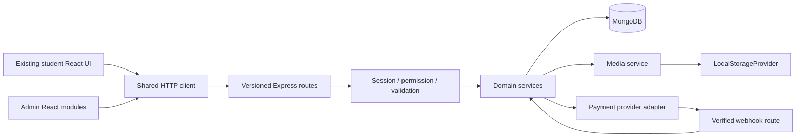

# Proposed backend architecture

## Stage 3 implementation update

Identity/session/security/email modules are implemented in the existing JavaScript modular monolith. See [backend README](../../backend/README.md) for actual files, contracts and commands. User, Session, AuthThrottle and AuditLog are the only new collections; AuthChallenge and pending staff invitations are embedded in User to allow atomic standalone updates. No business module placeholders, transactions, Razorpay SDK, production deployment or Stage 4 implementation were added.

HTTP order now includes real session validation and signed CSRF/Origin protection after JSON parsing. Shared requireSession/requirePermission/requireOwner helpers are authoritative future integration points. EmailService uses Nodemailer SMTP with a provider app password, mandatory STARTTLS or implicit TLS, redacted failures and fake transports in tests. SMTP is optional at startup; missing delivery configuration does not pretend success.

User.activeSessionId CAS protects student single-session transfer; securityVersion invalidates obsolete credentials after reset/change. Embedded audit outbox events commit with identity changes and are idempotently drained into AuditLog. Maintenance retries audit and removes expired challenges hourly and on startup. MongoDB standalone is explicitly approved for Stage 3. The transaction/payment architecture below remains a Stage 6 proposal requiring a separately approved consistency strategy.


Stage 2 implementation update (23 October 2026): the shared foundation is now implemented in `backend/`; the business module tree below remains a later-stage proposal. Implemented files: `src/app.js`, `src/server.js`, centralized env/database/logger config, HTTP middleware/errors, local storage contract/provider, utilities and only `modules/health/health.routes.js`. No empty business modules, models, CRUD/auth/upload/payment routes or SDK stubs were generated. See [backend setup and boundaries](../../backend/README.md). Existing frontend modules and root scripts are unchanged; the new HTTP client is not wired to mocks. Stage 3 was separately approved and is recorded above; Stage 4+ requires new approval.

Status: Stage 2 shared foundation implemented; business architecture below remains a proposal for later-stage approval. Traceability IDs F01-F26 are defined in document 02. JavaScript Node/Express modular monolith with MongoDB/Mongoose; existing frontend and `/admin/*` mount retained. Stage 2 dependency/runtime pins and actual verification are in the backend README; future modules still need compatibility/security checks. No claim is made that existing frontend dependency versions are vulnerability-free.

Confirmed business decision, 23 October 2026: **Razorpay is the selected payment gateway for all applicable paid registration fees, book purchases, prepaid coaching passes and renewals.** Use Razorpay Standard Checkout with backend-created Razorpay orders. Gateway selection is settled; fee amounts, access/review conditions, tax treatment, refund rules and invoice compliance remain Q01/Q02/Q09 decisions. Recurring Razorpay subscriptions remain out of scope. Development and integration testing use Test Mode only; live payments require explicit approval. The exposed test secret is compromised: owner-confirmed revocation/rotation is a mandatory gate before payment integration, not merely before launch.

## Proposed structure

```text
backend/
  package.json
  .env.example
  src/
    app.js                      Express assembly, export for integration tests
    server.js                   validated startup, connection, listen/shutdown
    config/                     env, database, logger, session, storage
    middleware/                 requestId, session, permission, validate, errors
    modules/
      auth/                     login, registration, recovery, device transfer
      users/                    profile, preferences, account administration
      applications/             study, tuition, faculty intake + documents
      institutions/             universities, colleges, college programs
      admissions/               enquiries, statuses, internal notes
      franchises/               applications, approval, tie-up eligibility
      taxonomy/                 boards, classes, subjects, programs, geography
      books/                    public catalogue, preview, book publishing
      coaching/                 course catalogue, subjects/chapters, lessons
      learning/                 entitlements, enrollment, progress, bookmarks
      commerce/                 orders, prices/plans, payment attempts, invoices
      results/                  issuer config, exams, trusted records, history
      content/                  page sections, faculty, banners, settings
      notifications/            audience publication and per-user read state
      media/                    metadata, uploads, protected delivery
      audit/                    append-only activity and dashboard aggregates
    storage/
      StorageProvider.js        documented provider contract
      LocalStorageProvider.js
      index.js                  provider selection
    jobs/                       media cleanup, notifications, reconciliation
    utils/                      errors, pagination, money, dates, safe IDs
  uploads/                      development only; ignored; external volume in prod
  tests/                        unit, integration, fixtures
```

Each module owns `*.routes.js`, `*.controller.js`, `*.service.js`, `*.model.js` and `*.validation.js` as needed. Use explicit Mongoose queries in services for simple CRUD; add a repository only where query reuse or transactional coordination merits it. Do not create a second top-level controllers/services tree duplicating module files. Middleware cannot implement pricing or entitlement decisions. Controllers translate HTTP; services enforce domain rules; models enforce persistence constraints.



## Boundaries and cross-module rules

| Owner | Owns | Cross-module contract |
|---|---|---|
| Auth/users | identity, sessions, account status | `requireSession`, effective permissions; single canonical user |
| Applications | three typed registration intakes, applicant files, fee state | account activation after verified fee; faculty application never automatically receives admin permissions |
| Institutions | University -> College -> CollegeProgram | admissions validate selected program belongs to active college; franchises validate selected parent university |
| Books/coaching | published educational definitions | content queries do not contain user-specific expiry/progress; protected media references remain private |
| Learning | BookEntitlement, Enrollment, LearningProgress | commerce grants rights once; media checks rights at delivery time |
| Commerce | price resolution, order snapshots, attempts, verified captured state | applies enrollment/fee effects in transaction; does not accept frontend amount/status as authority |
| Results | issuer/exam/record source validation | publication requires provenance; history must be scoped to current user and approved lookup policy |
| Content | editable business copy/config, allowlisted links/visual variants | cannot edit route identifiers, executable templates, permissions or secrets |
| Media | upload lifecycle, file identifiers and access | domain records reference MediaAsset IDs; provider path never leaks |
| Notifications/audit | notices/read state, audit events and aggregates | events describe committed facts; internal notes never returned publicly |

College programs are not coaching courses. Result issuers may refer to a partner university/college but remain distinct from book/coaching boards. Faculty display profiles are CMS content, not necessarily login accounts. Course passes are prepaid time-limited access, not evidence of a recurring-billing requirement.

## Confirmed payment service boundary and lifecycle

Commerce owns a PaymentService and a provider adapter contract such as `createOrder`, `verifyCheckoutSignature`, `getOrder`, `getPayment` and `verifyWebhookSignature`. RazorpayPaymentProvider implements this contract; only that adapter depends on the Razorpay SDK and provider credentials. Registration, books and learning call commerce services with product/application identifiers; they never invoke Razorpay SDK methods directly. This is an in-monolith boundary, not an additional service deployment. Reuse Order, PaymentAttempt and Job/outbox; no new payment collection or duplicate endpoint is needed.

The authoritative sequence is:

1. Backend authenticates the buyer or validates the scoped registration capability, resolves current approved product/plan/fee pricing and currency, and validates availability. Frontend price, payment status and local ownership flags are never authoritative.
2. A54 persists an internal pending Order with immutable price snapshot and owner-scoped idempotency key. A55 claims provider-order creation and calls the Razorpay adapter outside the MongoDB transaction, passing an internal correlation reference. It persists the Razorpay order binding before returning Checkout information.
3. Frontend launches Standard Checkout using only the publishable Key ID, backend-created Razorpay order ID, amount/currency and necessary merchant/prefill fields. Checkout callback or dismissal is a UI signal, not proof of purchase.
4. A56 verifies the Checkout signature using the Razorpay order ID saved by the backend, compares callback order IDs, then fetches provider records. It verifies capture, bound Razorpay order/payment relationship, internal order ownership, immutable amount/currency and environment. An authorized-but-uncaptured payment stays pending.
5. A57 independently verifies the webhook signature over raw bytes with the webhook secret and durably records the event before acknowledgment. Callback, webhook and reconciliation all enter the same verification/settlement service; delayed or out-of-order events cannot regress a captured payment.
6. A MongoDB transaction records verified payment evidence and the paid order, applies the appropriate book entitlement, per-user coaching enrollment/renewal or registration fee eligibility/activation exactly once, and records audit/outbox effects. Registration review/password setup gates remain in force; paying a fee does not bypass approval or grant all courses.
7. Frontend retrieves A58 authoritative payment and fulfillment status, then refetches owned books, enrollments or application/account state. A 'payment received, activation pending' state must remain distinct from completed fulfillment.

Exactly-once activation is a database effect built on idempotent processing, not a claim of exactly-once network delivery. Scope creation keys to the owner and canonical request hash; reject changed payload under the same key. Deduplicate callback settlement by provider payment/order binding, webhook delivery by provider event ID, and activation/renewal by internal source order. Use unique indexes, conditional state transitions, atomic leases and one fulfillment marker inside the transaction. Outbox email/notification work also uses stable keys.

Cancellation/dismissal and failed attempts grant nothing and do not make an internal order permanently unpayable if a legitimate capture later arrives. Pending capture, delayed webhook and lost callback show pending and support bounded A58 polling plus server reconciliation. Network timeout during Razorpay order creation is an uncertain external outcome: retain correlation/creation state and reconcile it before retrying creation; do not assume the Orders API provides request-key idempotency or that receipt alone guarantees uniqueness. Temporary DB failure after capture leaves no partial committed entitlement; webhook retry and scheduled scanning of unresolved orders recover settlement. A database outage must not acknowledge an event that was not durably accepted. Multiple captured payments against one internal order are flagged for investigation and never grant or extend twice; refund treatment remains a business decision.

Provider mechanics are checked against [Razorpay Standard Checkout/server integration](https://razorpay.com/docs/payments/server-integration/nodejs/integration-steps/) and [webhook delivery guidance](https://razorpay.com/docs/webhooks/best-practices/). The sequence and deduplication rules above are KITSS planning requirements, not implemented behavior.

## Request and failure handling

Recommended middleware order: proxy configuration with explicit trusted hops -> request ID -> secure headers -> exact-origin CORS -> raw-body Razorpay webhook route with its own limit/signature check -> bounded JSON parser -> session -> origin/CSRF checks for cookie-authenticated mutations -> router -> not-found -> centralized error serializer. Upload routes get multipart-specific limits. Webhooks use provider signatures rather than browser CSRF tokens.

Return typed domain errors mapped to 400 malformed input, 401 unauthenticated, 403 forbidden, 404 absent/unavailable, 409 conflicting revision/duplicate, 413 upload limit, 415 unsupported file, 422 valid syntax but invalid business input, 429 throttled, 503 unavailable dependency. Unexpected errors return generic 500 plus request ID. Never expose Mongo queries, stack traces or private applicant data. Logs are structured with redaction, route/status/latency/request ID; no passwords, OTPs, cookies, raw Aadhaar or document payloads. Audit records contain actor, action, resource, bounded safe diff and timestamp.

## Consistency, jobs and deployment

Use unique indexes for idempotency and ownership, conditional writes for state transitions, optimistic revision checks for admin edits, and MongoDB transactions for captured payment -> paid order -> entitlement/application activation -> audit/outbox records. Require replica-set-capable MongoDB even in payment integration tests. Provider calls happen outside the database transaction, with a recoverable pending state and reconciliation; never hold a database transaction open during Checkout.

Start with a small scheduled worker using persisted job/outbox records and atomic leasing: send account/recovery email, reconcile pending payments, clean abandoned uploads and deliver notifications. TTL expiry alone is not authorization: every request checks expiry and revocation synchronously. No Redis, queues, WebSockets or microservices are required initially. Add infrastructure only on measured workload needs. Multiple API replicas require shared persistent media access or a future object provider, shared sessions/rate limits and single-lease jobs.

Liveness reports process availability; readiness verifies database and required volume access without exposing secrets. Graceful shutdown stops new requests, drains work, closes database connections and releases leases. Production requires database/file backups, tested restores, migration scripts with dry run and rollback, TLS, monitoring and operational runbooks.

The security baseline follows [Express production security guidance](https://expressjs.com/en/advanced/best-practice-security/). Multi-document consistency uses [MongoDB transactions](https://www.mongodb.com/docs/manual/core/transactions/). These support infrastructure choices; business behavior remains the proposed repository-specific design above.
## Stage 4 implementation — 24 October 2026

The approved institutions module now owns taxonomy, university/college/program publishing, admission enquiries and franchise drafts/review. Existing app/server composition and auth/Origin/CSRF middleware are reused. Business writes use validation, session-derived actors, revisions, bounded history and a durable per-document audit outbox; startup/hourly maintenance retries audit delivery.

Standalone MongoDB reference integrity uses one operational DomainLock record shared by all module writers. Its durable owner has no TTL or automatic takeover: a crashed writer fails subsequent writes closed with DOMAIN_BUSY. This deliberately trades availability for safe hierarchy checks; it is not a multi-document transaction or payment consistency solution. See backend README for recovery. No payments, business registration, public uploads, cloud adapter or automatic franchise affiliation/account grants were added.


## Stage 5 implementation status - 24 October 2026

The Stage 5 publishing module owns Book, PageContent, Banner, FacultyProfile and SiteSettings; media owns the MediaAsset lifecycle through the existing StorageProvider. app.js assembles its router; server.js initializes additive indexes and runs startup/hourly audit/cleanup maintenance. No second backend, transactions, replica-set initialization, cloud adapter or payment service was introduced.

All Stage 4/5 reference-changing writers share the existing durable domainLocks/stage4-hierarchy mutex. Revision compare-and-set and an embedded audit outbox make each record change atomic on standalone MongoDB. Draft fields and immutable publishedSnapshot are separate: editing a live record does not silently republish it. A crashed lock fails closed; use the Stage 4 stop-all-writers/operator-recovery procedure. This availability tradeoff does not solve future payment settlement.

Media writes persist an IO intent before disk operations, journal promotion destinations and retry tracked cleanup. Parser subprocesses have time/memory/input bounds. ClamAV is an optional local scanner adapter, never a trust override. PaymentService/RazorpayPaymentProvider remains a future Stage 6 boundary.

## Stage 6 adopted implementation - 24 October 2026

Stage 6 is authorized for safely achievable offline commerce. The implemented PaymentService and RazorpayPaymentProvider are in the existing commerce module. Documented HTTPS APIs use native fetch; no Razorpay SDK or external queue is needed. All provider calls are denied until rotated Test Mode credentials and a deliberate local operator validation record match. No provider-connected call was made during implementation.

Adopted standalone design supersedes the earlier transaction proposal: Order is the authoritative single-document commerce aggregate, with embedded PaymentAttempt observations, immutable product/price/owner/provider-scope snapshots, capture evidence, revision CAS, durable fulfillment intent, reconciliation lease/retry state and audit outbox. Critical commerce writes request journaled w:1,j:true acknowledgment. This is not a multi-document transaction. BookEntitlement is a derived unique source-order effect; durable retries can recover a crash between capture, effect creation and acknowledgment. Access requires the actual non-revoked entitlement AND captured source order and current secure licensed media. No mathematical exactly-once claim extends to network delivery, disk loss or unauthorized database edits.

External order creation persists an intent before a single create call. Uncertain/abandoned creation is looked up by correlation receipt; an empty/ambiguous lookup never authorizes another create call. Signed webhook receipts use the existing Job model/collection, unique provider-scope/event keys and atomic expiring leases. Server workers run every 15 seconds; retries back off and stop for investigation after eight claims. Staff reconciliation schedules verification only. Registration/coaching charges and renewals are blocked by unresolved product/document/validity policy. See backend/STAGE6-REPORT.md and README for precise gates, assumptions and commands.


## Stage 7 implementation and superseding evidence - 24 October 2026

Stage 7 adds one coaching module (models/validation/service/routes/composition), not separate learning microservices or duplicate commerce/auth. Five collections supply Course, CoursePlan, Lesson, Enrollment and LearningProgress. Existing app/server initialize it after publishing and commerce, then run startup/hourly durable audit maintenance. Shared domain coordination protects catalogue references, revisions and publication; commerce retains journaled single-Order capture and source-order enrollment effects with the existing leased retry worker. Media accepts an optional learning-reference/authorization hook. Existing secure sessions/Origin/CSRF and fixed RBAC remain authoritative. No transaction was introduced. Actual configured-host metadata advertises a replica set; false requireReplicaSet configuration was previously mistaken for topology evidence. Separate standalone compatibility and actual-host acceptance are recorded distinctly in the Stage 7 report.

See [Stage 7 report](../../backend/STAGE7-REPORT.md) and [current backend runbook](../../backend/README.md). Historical earlier-stage status paragraphs remain snapshots, not current operational acceptance.
