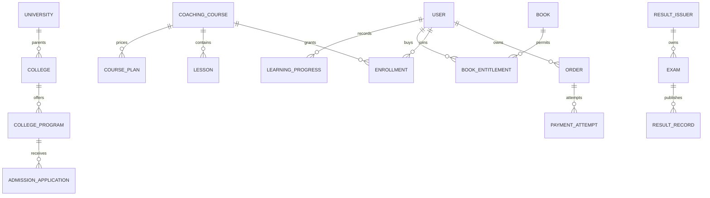

# MongoDB / Mongoose model proposals

## Stage 3 implemented persistence (supersedes identity proposals below)

User and Session implement the approved identity fields, normalized unique email/public IDs, private Argon2id hashes, roles/status/verification, timestamps and hashed opaque session credentials. Student IDs are backend-generated. Session expiry/revocation/idle/securityVersion and student activeSessionId are checked on every authenticated request; TTL deletion is only cleanup.

**Standalone adjustment:** AuthChallenge is a nested schema in User.challenges.verify/reset/transfer/invite. Each purpose has one current challenge ID, peppered HMAC, expiry, delivery flag, attempt counter (maximum five), issue timestamp and applicable target session/version. Consumption and the authorized identity change use one conditional User.findOneAndUpdate. Resends atomically replace the previous challenge after cooldown. Expired challenges are pruned at startup/hourly. Pending staff User records hold invitation state; no separate StaffInvitation or duplicate identity collection is created.

AuthThrottle persists HMAC-keyed account/IP fixed-window counters, with unique bucket IDs and TTL retention. AuditLog uses immutable event IDs; User.auditOutbox commits each event alongside the security mutation, retries idempotent upsert after outages and fails new security mutations closed at a bounded backlog. Sessions created before a losing CAS are never authoritative and are removed or TTL-cleaned. No multi-document transaction or replica set is needed for Stage 3.

Startup only creates additive indexes. Existing conflicting data fails startup safely; no syncIndexes, data reset or drop. Other proposed collections below remain unimplemented. Stage 6 must separately approve a transaction-capable topology or reviewed alternative; standalone auth tests do not establish payment atomicity.

Proposed models only. All are justified by the inspected features or their necessary operational/security support; no quiz, certificate-issuance, recurring subscription, cart, coupon or review-submission collections are included. Embedded structures avoid excessive normalization, while independent ownership, access checks and unbounded histories use references.

## Shared schema conventions

Notation: `!` required; `?` optional; `ref:X` ObjectId reference; `str`, `int`, `bool`, `date`, `obj`, `arr<T>` denote types. All collections have `_id:ObjectId`, `createdAt:date`, `updatedAt:date` via timestamps. All external IDs map through one serializer to `id`; never emit inconsistent `_id`/`id` objects. Store UTC dates, display in client locale. DOB is validated calendar date `YYYY-MM-DD` rather than a timezone-dependent instant. Money is nonnegative integer minor units with currency `INR` initially. Never store current daysRemaining or locale-formatted dates as authority.

Bound all strings/arrays at API and schema layers: names 1-160, short labels 1-80, short copy <=500, descriptions <=20,000, notes <=2,000, URLs <=2,048 (initial engineering limits, adjust to accepted content). Trim strings, normalize email/phone, reject unknown properties and unsafe update operators. Enums below are proposed domain enums; UI badges map labels without exposing storage specifics. Required fields without an explicit default must be supplied by the validated service; do not invent business data as schema defaults. Optional values default absent, collections/sets default empty, flags default false unless stated, users default pending, and definition/publication workflows default draft.

Catalogue/content models use `status`, `deletedAt?:date`, `revision:int=1`, actor IDs, and optimistic version checks. Soft-archive records referenced by purchases/applications. Do not make unique keys reusable on soft-delete by default. Financial/audit/result-published records are retained and corrected through explicit transitions/revisions, not generic CRUD deletion. No cascade deletion from university/college/course/book to user history.

Models marked private require explicit DTO projections and field-level access. `select:false` is a defense, not a replacement for authorization. Sensitive identity numbers should be minimized; if approved, encrypted value + last4 and no searchable plaintext. Encryption keys belong outside MongoDB; see Q05.

## Identity and intakes

| Collection / model | Fields beyond shared conventions | Constraints, indexes, defaults and lifecycle | CRUD / security |
|---|---|---|---|
| `users` / User | `publicId!:str`, `name!:str`, `emailNormalized!:str`, `phoneNormalized?:str`, `passwordHash?:str`, `roles!:arr<enum>`, `status!:pending/active/suspended/archived`, `emailVerifiedAt?:date`, `passwordChangedAt?:date`, `activeSessionId?:ref:Session`, `avatarId?:ref:MediaAsset`, `profile:obj` (DOB, gender?, parents?, board/class refs?, addresses?, WhatsApp?, guardian contact?, requested course/institute), `preferences:obj` (examAlerts=true, courseUpdates=true, promoAlerts=false, courseSelector={}) | unique publicId/email; partial phone index only if phone is made a unique login identifier Q03; `{status,createdAt}`, roles; roles default student for student activation, never from request. Profile fields optional unless intake requires them; age calculated, no stored coins/streak seed | create through activation/admin invite; read self/admin; patch allowed profile; suspend/archive; passwordHash private, never returned |
| `sessions` / Session | `tokenHash!:str`, `userId!:ref:User`, `kind!:student/admin`, `deviceLabel!:str`, `deviceIdHash?:str`, `expiresAt!:date`, `lastSeenAt!:date`, `revokedAt?:date`, `reauthenticatedAt?:date`, `csrfTokenHash!:str`, `rememberMe:bool=false` | unique tokenHash; TTL expiresAt; `{userId,kind,revokedAt}`. User.activeSessionId pointer is authoritative for student single-session policy. Expiry/revocation checked even before TTL deletion | create/rotate login, read/verify, revoke logout/transfer; no public list of hashes; retention configurable |
| `authChallenges` / AuthChallenge | `purpose!:reset/activate/email-change/device-transfer`, `userId?:ref:User`, `applicationId?:ref:RegistrationApplication`, `identifierHash?:str`, `tokenHash!:str`, `expiresAt!:date`, `attempts:int=0`, `maxAttempts:int`, `consumedAt?:date`, `targetSessionId?:ref:Session` | tokenHash unique; TTL expiresAt; index userId/purpose; short configurable expiry; compare hashes and atomically consume. Wrong attempts rate-limited; no raw OTP persisted | issue/consume only; no admin read of secrets; generic public acknowledgments |
| `registrationApplications` / RegistrationApplication | `reference!:str`, `kind!:study/tuition/faculty/coaching-profile`, `userId?:ref:User`, `draftCapabilityHash?:str`, `draftExpiresAt?:date`, `status!:draft/awaiting_payment/submitted/under_review/approved/rejected/activated`, `applicant!:obj`, `academic?:obj`, `addresses?:obj`, `experience?:obj`, `documents:arr<{purpose,assetId:ref:MediaAsset}>`, `identity?:{encryptedNumber,last4}`, `feeSnapshot?:{configRevision,amountMinor,currency}`, `orderId?:ref:Order`, `declaration?:{version,acceptedAt}`, `submittedAt?:date`, `review?:{actorId,reason}`, `notes:arr<{id,text,actorId,createdAt}>` | reference unique; `{kind,status,createdAt}`, userId, sparse orderId; defaults draft/empty docs+notes. applicant carries named form fields from F05-F07/F17; faculty experience includes institute,startDate,endDate?,isContinuing,course,contact,totalExperience,specializationNotes; validate dates/order and typed field allowlists. No client-controlled approval/fee | capability owner can create/edit own draft and submit; authenticated reviewer status/notes; archive or retention purge by policy. All applicant/identity documents private. Zero-fee coaching-profile behavior Q02 |

Study applicant: studentName -> name, DOB, father/mother, email/calling/WhatsApp, address/state/district/city/PIN, requested course/institute; certificate/result, ID and photo. Tuition adds guardian contact, board/class/school/schoolAddress/homeAddress and optional class ID. Faculty adds title, language and experience fields. Do not discard form fields during normalization; store submitted snapshot in application and copy only needed profile fields to User. Anonymous draft capability authorizes only that draft and its staged assets, not catalogue/paid media or another user's data.

## Institution hierarchy and admissions

| Collection / model | Fields | Constraints, indexes, defaults and lifecycle | CRUD / security |
|---|---|---|---|
| `universities` / University | `publicId!:str`, `name!:str`, `shortName!:str`, `logoId?:ref:MediaAsset`, `status!:draft/active/inactive/archived` | unique publicId, normalized shortName unique unless owner approves duplicates; name search; status index; draft default. Archive blocked when policy requires active children; public only active | admin CRUD/archive/status; public list only active projections |
| `colleges` / College | `publicId!:str`, `universityId!:ref:University`, `name!:str`, `code!:str`, `category!:University/College/School/Institute`, `collegeType?:str`, `description?:str`, `about?:str`, `address!:str`, `city!:str`, `district!:str`, `stateId!:ref:Taxonomy`, `country:str=India`, `pincode?:str`, `logoId/bannerId?:ref:MediaAsset`, `facilities:arr<str>=[]`, `contactInformation:{phone?,email?,website?}`, `admissionInformation?:str`, `verification:{state:unverified/verified,checkedAt?,actorId?,evidenceAssetId?}`, `ratingSummary?:{value,count,source}`, `status!:draft/active/inactive/archived` | unique publicId/code; `{universityId,status}`, `{stateId,district,status}`, category/status, bounded search fields; no inferred parent; no fake counts. Verified default false; review source required before publishing aggregate | admin create/update/archive/status; public active projections; internal evidence excluded |
| `collegePrograms` / CollegeProgram | `collegeId!:ref:College`, `name!:str`, `degreeType!:str`, `duration!:str`, `eligibility!:str`, `feeMinor!:int`, `currency=INR`, `description?:str`, `availableSeats?:int`, `admissionStatus!:open/closed`, `status!:draft/active/inactive/archived` | `{collegeId,status,admissionStatus}`; unique `{collegeId,name,degreeType}` if duplicate intakes not approved; fee >=0, seats >=0 integer, draft default; seats display is not seat reservation | admin CRUD/status; public active programs of active parent; referenced history retained |
| `admissionApplications` / AdmissionApplication | `reference!:str`, `userId?:ref:User`, `collegeId!:ref:College`, `programId!:ref:CollegeProgram`, `studentDetails!:{fullName,mobileNumber,email,dob?,city?,educationalQualification?,passingYear?,additionalInfo?}`, `programSnapshot!:obj`, `status!:new/contacted/in_process/approved/rejected`, `notes:arr<{id,text,actorId,createdAt}>=[]`, `statusHistory:arr<{from,to,actorId,at}>`, `idempotencyKey!:str` | reference unique; `{userId,createdAt}`, `{collegeId,status,createdAt}`, `{status,createdAt}`; idempotency scope+key unique; default new. Program must belong to college and admit at submission. Auth ownership Q04 | create enquiry; reviewer read/status/notes, owner summary if approved; no public PII listing, archive/purge by policy; approval does not reserve seat |
| `franchiseApplications` / FranchiseApplication | `reference!:str`, `universityId!:ref:University`, `collegeId!:ref:College`, `applicantUserId?:ref:User`, `draftCapabilityHash?:str`, `draftExpiresAt?:date`, `institution!:{name,type,yearEstablished?,website?,logoAssetId?}`, `programsOffered!:arr<str/ref>`, `contact!:{person,designation,email,mobile,alternateMobile?}`, `location!:{address,city,stateId,pincode,mapsUrl?}`, `documents:arr<{purpose,assetId}>`, `declaration!:{version,acceptedAt}`, `status!:draft/pending/approved/rejected`, `rejectionReason?:str`, `notes/statusHistory:arr`, `submittedAt?:date` | unique reference; `{status,createdAt}`, `{universityId,collegeId,status}`; parent membership validated; year <=current year; reject requires reason; default draft. At least one program; document-required rules Q06 | capability draft create/edit/submit; reviewer read/status/notes; private attachments; approval public effect explicit Q06, no automatic franchise login |

## Educational catalogues and access

| Collection / model | Fields | Constraints, indexes, defaults and lifecycle | CRUD / security |
|---|---|---|---|
| `taxonomies` / Taxonomy | `kind!:board/class/subject/program/language/state/district/qualification/designation/experience/institution_type`, `key!:str`, `label!:str`, `parentIds:arr<ref:Taxonomy>`, `metadata?:obj` (bounded subject icon key, safe display variant), `sortOrder:int=0`, `status!:active/inactive` | unique `{kind,key}`, `{kind,status,sortOrder}`, parentIds; no executable code; dependency validation/no cycles where hierarchy applies; active default | admin CRUD/archive, public facets; custom applicant text stays application text until moderated |
| `books` / Book | `publicId!:str`, `title!:str`, `subtitle?:str`, `boardId/classId/subjectId?:ref:Taxonomy`, `author!:str`, `languageId!:ref:Taxonomy`, `description?:str`, `keywords:arr<str>`, `priceMinor!:int=0`, `originalPriceMinor?:int`, `currency=INR`, `coverAssetId?:ref:MediaAsset`, `coverVariant/iconKey?:enum`, `documentAssetId!:ref:MediaAsset`, `pageCount!:int`, `toc:arr<{title,page}>`, `previewAssetIds:arr<ref:MediaAsset>`, `publishedAt?:date`, `edition?:str`, `ratingSummary?:{value,count,source}`, `status!:draft/published/archived` | unique publicId; `{status,boardId,classId,subjectId,languageId}`, publishedAt; title/author/keywords search index sized after workload. pageCount >0; TOC offsets <=pageCount; original>=sale; free derived price=0, discount derived. document required at publication, optional while draft | admin CRUD/publish/archive; public metadata and separate approved preview; never leak paid document key in detail |
| `coachingCourses` / CoachingCourse | `publicId!:str`, `title!:str`, `subtitle/description?:str`, `boardId/classId/stateId/programId/languageId?:ref:Taxonomy`, `subjectIds:arr<ref:Taxonomy>`, `facultyIds:arr<ref:FacultyProfile>`, `thumbnailId/bannerId?:ref:MediaAsset`, `durationLabel?:str`, `whatYouWillLearn/benefits:arr<str>`, `syllabus:arr<{id,subjectId,title,sortOrder,chapters:arr<{id,title,sortOrder}>,bookLinks:arr<{bookId,chapterId?,sortOrder,previewAllowed}>}>`, `ratingSummary?:obj`, `status!:draft/published/archived`, `publishedAt?:date` | unique publicId; publication/taxonomy facet indexes; bounded syllabus, no embedded learner progress; lecture/book counts derived. Valid media/lesson/plan requirements checked on publish; generated degree rows with empty syllabus cannot be sold as full content | admin CRUD/syllabus/publish; public published metadata; student syllabus projection with entitlement state |
| `lessons` / Lesson | `courseId!:ref:CoachingCourse`, `subjectKey!:str`, `chapterKey?:str`, `title!:str`, `summary?:str`, `teacherId?:ref:FacultyProfile`, `videoAssetId?:ref:MediaAsset`, `durationSeconds?:int`, `resourceLinks:arr<{assetId,title,downloadAllowed}>`, `sortOrder!:int`, `previewAllowed:bool=false`, `status!:draft/published/locked/archived` | `{courseId,subjectKey,sortOrder}`, courseId/status; validate syllabus keys belong to course; duration from actual media; video required for publication; locked denies playback even if enrolled | admin CRUD/order/publish/archive; public preview metadata only; protected delivery checks hierarchy and state |
| `coursePlans` / CoursePlan | `courseId!:ref:CoachingCourse`, `name!:str`, `durationDays!:int`, `priceMinor!:int`, `originalPriceMinor?:int`, `currency=INR`, `features:arr<str>`, `popular:bool=false`, `sortOrder:int=0`, `status!:draft/active/inactive` | `{courseId,status,sortOrder}`; unique courseId/name/revision strategy; positive duration, sane upper bound agreed Q02; explicit duration not inferred from title; old order snapshots retained | admin create/version/retire; public active plans; never mutate purchased validity retroactively |
| `bookEntitlements` / BookEntitlement | `userId!:ref:User`, `bookId!:ref:Book`, `orderId?:ref:Order`, `source!:purchase/admin_grant`, `grantedAt!:date`, `expiresAt?:date`, `revokedAt?:date`, `reason?:str` | unique `{userId,bookId}`; `{userId,revokedAt}`; indefinite book access proposed from lifetime-copy claim Q04; revocation must be explicit and audited, not derived from browser IDs | server create/upsert after verified order; owner read; authorized exceptional grant/revoke with reason; no generic user write |
| `enrollments` / Enrollment | `userId!:ref:User`, `courseId!:ref:CoachingCourse`, `planId?:ref:CoursePlan`, `orderId?:ref:Order`, `startsAt!:date`, `expiresAt?:date`, `state!:active/revoked`, `source!:paid/free/admin_grant`, `renewalHistory:arr<{orderId,oldExpiry,newExpiry}>` | unique `{userId,courseId}`, `{userId,state,expiresAt}`, expiresAt. Paid requires verified captured source and explicit duration; renew max(now,currentExpiry)+duration proposed Q02; history bounded or derive from Orders | system create/renew/revoke; user reads; expiry computed at request time, never a course field |
| `learningProgress` / LearningProgress | `userId!:ref:User`, `resourceType!:book/lesson`, `bookId?:ref:Book`, `lessonId?:ref:Lesson`, `courseId?:ref:CoachingCourse`, `status!:not_started/in_progress/completed`, `currentPage?:int`, `positionSeconds?:number`, `completedAt?:date`, `bookmarkPages:arr<int>=[]`, `wishlisted:bool=false`, `lastActivityAt!:date`, `clientRevision?:int` | unique partial `{userId,bookId}` for book and `{userId,lessonId}` for lesson; `{userId,lastActivityAt}`; exactly one resource ref; bounds from actual document/video; wishlist allowed without entitlement, progress/bookmark mutations require read access. Empty state on new account | owner read/upsert/explicit reset, no admin editing earned completion; summary metrics derived; bookmark set add/remove idempotent |

Book reuse: course bookLinks reference the same Book documents. A paid book can be authorized through a direct entitlement or a currently entitled course link. Course access does not imply a permanent standalone book purchase. Personal reading position can be shared for the same Book; courseId context is validated for access. If owners need course-specific page progress, decide before changing the unique key.

## Commerce, trusted results and content

Stage 6 supersedes the historical separate-attempt/transaction proposal below with the adopted standalone aggregate refinement at the end of this document. Unimplemented course/registration/fiscal fields remain proposals.

Razorpay is confirmed for all applicable paid registration fees, book purchases, prepaid coaching passes and renewals. The existing Order/PaymentAttempt/Job design remains the payment model; no recurring-subscription or duplicate payment collection is introduced. The following payment lifecycle refinements are part of the proposal, not implemented schema changes.

| Collection / model | Fields | Constraints, indexes, defaults and lifecycle | CRUD / security |
|---|---|---|---|
| `orders` / Order | `reference!:str`, `userId?:ref:User`, `applicationId?:ref:RegistrationApplication`, `ownerCapabilityHash?:str`, `items!:arr<{kind:book/course_plan/registration_fee,productId,quantity,descriptionSnapshot,priceMinor,originalPriceMinor,durationDays?}>`, `amountMinor!:int`, `currency!:str`, `status!:pending/paid/failed/cancelled/refunded`, `idempotencyKey!:str`, `requestHash!:str`, `paymentMode!:test/live`, `fulfillmentStatus!:pending/applied/blocked`, `fulfilledAt?:date`, `paidAt?:date`, `invoiceAssetId?:ref:MediaAsset`, `invoiceNumber?:str` | unique reference; unique scoped owner/idempotencyKey; `{userId,createdAt}`, status/updatedAt, fulfillmentStatus/updatedAt, applicationId. Default pending order/fulfillment; server-quoted items only, canonical request hash prevents changed-payload retries; fee draft capability supports pre-login payment; immutable price/customer snapshot and approved tax snapshot when policy confirmed; invoice number unique sparse | system verified transition only; owner read/invoice; admin read/reconcile; fulfillment marker and access writes commit atomically once per order; refunds/tax/invoice rules Q09 |
| `paymentAttempts` / PaymentAttempt | `orderId!:ref:Order`, `provider!:razorpay`, `providerOrderId?:str`, `providerPaymentId?:str`, `amountMinor!:int`, `currency!:str`, `paymentMode!:test/live`, `creationKey!:str`, `creationState!:pending/creating/ready/unknown/failed`, `correlationReference!:str`, `leaseUntil?:date`, `status!:created/authorized/captured/failed/refunded`, `verifiedAt?:date`, `verificationSource?:checkout/webhook/reconciliation`, `failureCode?:str`, `paymentHistory:arr<{providerPaymentId,status,observedAt,failureCode?}>`, `processedEventIds:arr<str>`, `reconciledAt?:date` | partial unique provider+mode+providerOrderId and provider+mode+providerPaymentId; unique orderId/creationKey; `{orderId,createdAt}`, creationState/updatedAt, status/updatedAt. Provider order ID absent until creation succeeds; ready required before Checkout. Verify captured amount/currency/order relationship and mode against immutable Order; history bounded, transitions never regress capture; event dedup via Job key; no PAN/CVV/raw secret | adapter and settlement service own transitions; recorded history supports failed retries on a bound Razorpay order; chosen captured payment grants once; admin sees redacted verification/history metadata only |
| `resultIssuers` / ResultIssuer | `key!:str`, `type!:school/university/institute`, `name/fullName!:str`, `universityId/collegeId?:ref`, `logoAssetId?:ref:MediaAsset`, `fieldSchema!:arr<{id,label,type:enum,required,options?,minLength?,maxLength?,validationRuleKey?}>`, `source!:{kind:approved_import/authorized_api,description,approvedBy,approvedAt}`, `status!:draft/active/inactive` | unique key; type/status; no arbitrary JS/regex evaluation, use bounded validation rule keys; no trusted lookup for freeform OTHER_INSTITUTE without registered issuer | admin config/source approval; public schema projection; source credentials in env/provider vault, not this document |
| `exams` / Exam | `issuerId!:ref:ResultIssuer`, `key!:str`, `title!:str`, `year!:int`, `session!:str`, `level?:str`, `course?:str`, `semester?:str`, `publishedAt?:date`, `status!:draft/published/withdrawn` | unique `{issuerId,key}`, issuerId/year/status; versioned lookup schema and grade rules; defaults draft | admin create/review/publish/withdraw, public published exam metadata |
| `resultRecords` / ResultRecord | `examId!:ref:Exam`, `rollNormalized!:str`, `userId?:ref:User`, `student!:{name,dob?,parents?,photoAssetId?,schoolName?,schoolCode?,centerCode?,enrollmentNumber?,admitCardId?}`, `subjects!:arr<{code,name,maxMarks,obtained,theory?,maxTheory?,practical?,maxPractical?,credits?,grade?}>`, `totals!:{max,obtained,percentage,grade?,sgpa?,cgpa?,status}`, `source!:{batchId,externalId?,checksum,verifiedBy,verifiedAt}`, `issueDate!:date`, `revision!:int`, `supersedesId?:ref:ResultRecord`, `status!:draft/published/withdrawn` | unique `{examId,rollNormalized,revision}` and partial unique current published roll per exam; `{userId,status}`, source batch; marks 0<=obtained<=max, totals reconciled with issuer rules; no fuzzy matching or generation; immutable published correction revision | controlled import/draft/review/publish; authorized lookup, retention policy; no generic public listing; PII private |
| `resultHistory` / ResultHistory | `userId!:ref:User`, `resultRecordId!:ref:ResultRecord`, `lastViewedAt!:date` | unique userId/resultRecordId; `{userId,lastViewedAt}`; never store raw search DOB/identifier copies unnecessarily | system upsert authorized lookup, owner read; delete by retention/privacy policy |
| `pageContents` / PageContent | `key!:home/about/categories/navigation`, `sections!:arr<{key,type:enum,heading?,body?,items:arr<bounded obj>,mediaAssetIds?,linkKeys?}>`, `revision!:int`, `status!:draft/published`, `publishedAt?:date`, `publishedSnapshot?:obj` | key unique; published snapshot supports draft edits without replacing live content; explicit allowlisted templates/links; sanitize rich text if actually needed; no HTML/JS execution | CMS edit/preview/publish with revision check; public published projection |
| `banners` / Banner | `placement!:home/my_courses/results_top/results_bottom`, `title!:str`, `subtitle/tag/ctaText?:str`, `imageAssetId?:ref:MediaAsset`, `link!:{type:internal/external,target}`, `collegeId?:ref:College`, `variant!:enum`, `sortOrder:int=0`, `startsAt/endsAt?:date`, `status!:draft/published/archived` | placement/status/sortOrder; date ordering, internal target registry and http(s) external validation; empty placement safe | CMS CRUD/schedule/publish/archive; public active-window query |
| `facultyProfiles` / FacultyProfile | `name!:str`, `role!:str`, `qualifications/experience/specialty/badge?:str`, `trackTags:arr<enum>`, `portraitAssetId?:ref:MediaAsset`, `mentoredCount?:int`, `sourceNote?:str`, `userId?:ref:User`, `sortOrder:int`, `status!:draft/published/archived` | status/sortOrder, trackTags; counts require approved evidence; user link optional | faculty/CMS CRUD/publish; public display, no educator permissions inferred |
| `siteSettings` / SiteSettings | `key!:str`, `value!:typed obj`, `revision!:int`, `updatedBy!:ref:User` | key unique; keys limited to brand/support/footer/registrationFees/declarations/publicFeatures; validate per key; private operational settings separate DTO | admin settings edit/audit; public safe projection; no passwords/payment keys/upload security floors |
| `notifications` / Notification | `title/message!:str`, `category!:enum`, `iconKey/colorVariant?:enum`, `link?:allowlisted obj`, `audience!:{kind:all_students/users/course,userIds?,courseId?}`, `publishedAt?:date`, `status!:draft/published/archived` | status/publishedAt, audience courseId; bounded targeting, no arbitrary query language | admin compose/preview/publish/archive; user query only targeted published notifications |
| `notificationReceipts` / NotificationReceipt | `notificationId!:ref:Notification`, `userId!:ref:User`, `readAt?:date`, `deliveredAt?:date` | unique notificationId/userId; `{userId,readAt}`, userId/notificationId; atomic idempotent read-one/all | system/owner upsert; no cross-user update; archive retention separate from display |

## Storage and operations

| Collection / model | Fields | Constraints / lifecycle | CRUD / security |
|---|---|---|---|
| `mediaAssets` / MediaAsset | `provider!:local`, `key!:str`, `visibility!:public/private`, `purpose!:enum`, `originalName!:str`, `mime!:str`, `bytes!:int`, `checksum!:str`, `ownerUserId?:ref:User`, `draftOwner!?:{kind,id,capabilityHash}`, `width/height/pageCount/durationSeconds?:number`, `status!:staged/quarantined/ready/attached/deleting/deleted/failed`, `retentionUntil?:date`, `variants:arr<{key,mime,bytes}>` | unique provider/key; `{status,createdAt}`, owner/purpose, checksum index (not global dedup of private ownership); no absolute paths. Asset attach validates ownership/purpose and becomes durable | staged upload->validate->attach; logical delete only after reference check; authorized range/download; metadata private except public projection |
| `auditLogs` / AuditLog | `actorId?:ref:User`, `action!:str`, `resourceType/id!:str`, `requestId!:str`, `safeChanges?:obj`, `reason?:str`, `outcome!:success/denied`, `occurredAt!:date` | resourceType/id/time, actorId/time, action/time; append only; redacted before insertion; retention by approved policy, no universal TTL | system append; authorized admin read/filter; no generic update/delete |
| `jobs` / Job (outbox included) | `key!:str`, `kind!:email/notification/payment_event/payment_reconcile/media_cleanup/result_import`, `payload!:bounded obj` of IDs/verified payment-event evidence, `state!:pending/leased/done/failed`, `availableAt!:date`, `leaseUntil?:date`, `attempts:int=0`, `maxAttempts!:int`, `lastErrorCode?:str`, `resultSummary?:{counts,rowErrors,sourceChecksum}`, `completedAt?:date` | unique key ensures event/idempotency; `{state,availableAt}`, leaseUntil; atomic lease, retry backoff; purge completed records only after dedup retention window; result import summaries bounded, full private report can be a MediaAsset | system enqueue/claim/finish/retry; admin operational summary, no raw private payload; no unnecessary external queue |

## Relations and concurrency

References are not foreign keys: services explicitly validate parents and transactions prevent concurrent archive/application races where required. Avoid deeply populating complete documents; use projected queries and aggregate counts. Embed finite TOCs/subject-group definitions/subject marks; keep media bytes outside MongoDB and unbounded learning/activity outside User/Course.

For payment callbacks and webhooks, unique provider IDs and conditional status updates plus a transaction grant access exactly once. Renewals atomically extend the current expiry and deduplicate source order. Record verified payment, Order paid/fulfillment marker, registration fee effect or entitlement/enrollment, audit and outbox in the same transaction; never commit a marker separately from access. A failed attempt or Checkout dismissal does not override later verified capture. Multiple captures on one internal order require an operational exception, not a second activation or invented refund policy. Reconciliation queries unresolved creation/payment/fulfillment state after outages. Student session transfer atomically updates User.activeSessionId; old sessions cease to authorize even if revocation cleanup lags. Notes append atomically with authenticated actor; concurrent admin changes require expected revision. Progress uses explicit completion/bookmark PUT/DELETE and bounded checkpoints to avoid double-toggle bugs; decide last-writer versus revision rejection for cross-device updates (default revision check and refetch). Publish archived/unready media atomically rejected. Replica set is required for multi-document payment guarantees; [MongoDB transaction documentation](https://www.mongodb.com/docs/manual/core/transactions/) establishes the mechanism.

Use the existing `jobs` collection also for signed payment-event receipt/settlement (`kind=payment_event`) with unique key `razorpay:<mode>:<eventId>` and bounded verified evidence/IDs. A durable receipt records processing state, not an assertion of payment success. Leased retries and scheduled reconciliation reuse the same settlement service; dedup receipts must remain long enough to cover provider replay/operational retry, with retention confirmed operationally. No separate webhook/payment-history collection is needed. Registration eligibility and Q01 review gates are distinct from fee-paid state; fee amounts and fiscal policies are not finalized by choosing Razorpay.
## Stage 4 implemented schema refinement — 24 October 2026

Implemented collections: taxonomies, universities, colleges, collegePrograms, admissionApplications and franchiseApplications. Additive indexes enforce canonical taxonomy kind/key, university short name, college code, program college/name/degree and owner-scoped intake idempotency. Existing data is never seeded/reset; incompatible indexes fail startup for investigation. University/college references are immutable on edit. Archive retains records and historical intake snapshots; active descendants block parent deactivation/archive.

DomainLock is one additional operational collection (domainLocks), necessary to serialize reference checks and mutations on standalone MongoDB; it is not a new business entity. Ownership is durable, never TTL-reclaimed or automatically stolen. Mutations use expectedRevision CAS and atomic embedded auditOutbox append; AuditLog upserts deduplicate delivery. Intake notes are independent idempotent appends with server actor/timestamp and do not change status. History bounds reject excess writes safely.

Guest franchise capabilities are random-looking HMAC credentials, stored only as hashes, valid 24 hours; authenticated drafts remain owner-bound. Drafts contain typed intake fields and pendingDocuments metadata only, never uploaded file bytes or valid MediaAssets. Admission stores the verified user and immutable program/college/university/fee snapshot; no admission or franchise status grants paid entitlements.

## Stage 5 implementation status - 24 October 2026

Implemented exactly six additional business collections: books, pageContents, banners, facultyProfiles, siteSettings and mediaAssets. See backend/src/modules/publishing/publishing.models.js for the executable schemas. No unrelated business models or background-job collection was generated.

Book records include generated publicId, metadata/taxonomy IDs, explicit integer-minor-unit pricing, pricingApproved, rightsConfirmed/rightsNote, compatible cover/document/preview IDs and bounded TOC. No missing price defaults to zero. Parsed media supplies page counts. CMS sections are bounded typed plain text; faculty publication requires source evidence; site settings are allowlisted typed groups. Published snapshots retain their live media references while drafts change.

Media records hold owner, actor, purpose, visibility, generated private provider key, actual MIME/size/SHA-256/dimensions/pages, idempotency request hash, scan state, lifecycle state and durable cleanup keys/deadline. Provider/cleanup keys are excluded from DTOs. Authoritative references are derived from draft and snapshot foreign keys, including archived retained records, under the shared mutex. Referenced files cannot be deleted.

Indexes are additive createIndexes calls only: unique Book.publicId, PageContent.key, SiteSettings.key, MediaAsset.key and (ownerUserId,idempotencyKey); catalogue/publication, banner ordering, faculty ordering and media status/checksum indexes. No syncIndexes, drops, resets or transactions. The authorized development verification created labelled drafts only; retained identifiers and counts are in backend/STAGE5-DEVELOPMENT-VERIFICATION.json.

## Stage 6 adopted implementation - 24 October 2026

Stage 6 adopts four additive collections: orders (Order), bookEntitlements (BookEntitlement), registrationApplications (RegistrationApplication) and jobs (Job). PaymentAttempt is an embedded schema in Order, not a separate collection: capture evidence and obligation can commit atomically on standalone MongoDB. No Enrollment/CoursePlan or duplicate payment-history collection was generated while the course domain/policies are absent.

Order contains owner, one currently supported book product snapshot, positive approved amountMinor/INR, Test Mode, provider scope, simulation label, owner-scoped idempotency hash, one provider creation intent/binding, bounded verified attempt history, unique payment references, captured source, fulfillment effect marker, durable job state and audit outbox. Unique indexes cover reference, owner/key, provider/mode/providerOrderId, provider/mode/paymentReferences, and owner/book product. One aggregate per owner/book is intentional; retries resume it rather than allowing multiple open purchases. Expiration prevents starting an expired order but does not discard a later verified capture.

BookEntitlement has unique orderId and unique userId/bookId, source=purchase, grantedAt and explicit revocation. Recovery upserts the stable effect and verifies it before acknowledgment; revocation cannot be resurrected by retry. RegistrationApplication stores verified owner, all allowlisted non-document form fields, required-document slots, draft-only/blocked payment state, fee metadata snapshot where approved, revisions, notes and audit. Identity numbers/file payloads are rejected, not silently discarded. No paid activation is enabled.

Job stores only verified event identity/hash and safe provider/order/payment IDs, processing state, token, attempts, due time and lease. It is a durable receipt, not proof of capture. No PAN/CVV/raw provider payload is stored. Critical schema writes are journaled; indexes are additive only. No syncIndexes, collection drops, database resets, transactions or topology changes. Configured-host initialization/persistence remains blocked by its 500-collection limit; isolated local evidence is explicitly separate.

## Stage 7 implementation and superseding evidence - 24 October 2026

Implemented five collections: coachingCourses (Course), coursePlans, lessons, enrollments, learningProgress. Course has revisioned draft fields and serialized public snapshots; sections have bounded stable keys/order. Plans have explicitly approved positive INR minor-unit price, days and verified-account eligibility, with no inferred validity/price/free policy. Lessons support authored plain text/private scanned PDF; unsafe or unsupported video references block publication. A partial unique Order owner/course index prevents duplicate first-purchase orders across different plans while switching/renewals remain unapproved. Enrollment has unique user/course and unique source order; immutable captured-order duration determines expiry, and revoked effects cannot be recreated. LearningProgress reuses the proposed combined book/lesson collection with partial unique user/book and user/lesson indexes; it owns wishlist/bookmarks/progress rather than browser storage or duplicate models. Order.product minimally extends its snapshot with courseId/durationDays/eligibility. Renewals/manual grants remain gated; no renewal-history success is claimed. Critical learning writes/audit delivery are journaled; standalone recovery assumptions remain those of Stage 6. The owner's explicit development-only backup/cleanup authorization supersedes historical no-drop restrictions only for confirmed KITSS development resources. Current application data was retained, 41 backed-up obsolete project databases removed, and new indexes initialized.

See [Stage 7 report](../../backend/STAGE7-REPORT.md) and [current backend runbook](../../backend/README.md). Historical earlier-stage status paragraphs remain snapshots, not current operational acceptance.

## Stage 10 additive operational fields

No collection is added. User gains `adminRevision` (default zero; absent legacy values treated as zero by CAS) for reasoned status/ordinary-staff permission management. Such changes also increment existing securityVersion, clear active student-session pointers and outstanding challenges, and append a durable audit outbox event. Embedded auth audit events and AuditLog gain an optional bounded `reason` (500 characters). Existing rows/indexes are preserved; no data migration/reset or index synchronization is performed. Operational job/account/book-rights/dashboard views read the existing models through safe projections.
