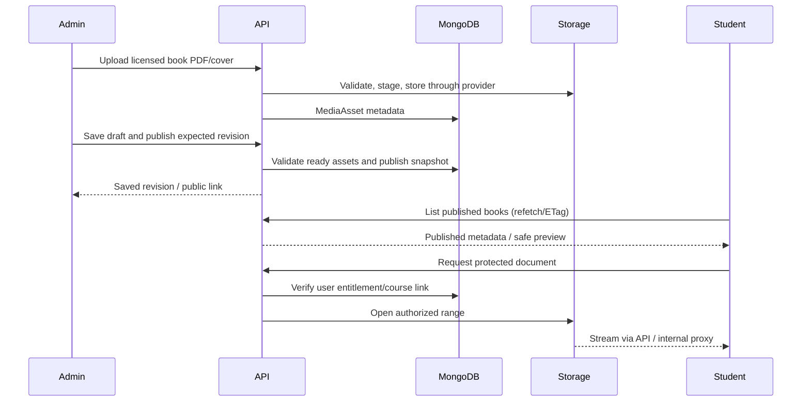

# Integration, data flows and quality assurance

## Stage 3 executed verification — 23 October 2026

Baseline frontend build passed; existing backend suite 25 passed/1 skipped. Windows sandbox initially blocked Node filesystem resolution; reruns outside it executed successfully. Use npm.cmd because npm.ps1 is blocked by workstation policy.

Final backend run with KITSS_AUTH_TEST_DB selecting a fresh guarded database: **45 discovered, 44 passed, 1 skipped, 0 failed/cancelled**. Only the legacy optional replica-set check skipped; a replica set is not required or claimed. Real MongoDB auth integration DID run in a separate unique database on the configured host, with fake mail/.invalid recipients. No application records were reset/dropped and no real bootstrap/email/payment was executed. Only test-created record IDs were deleted; empty isolated test collections/indexes may remain.

Coverage: normalized identity/hash/uniqueness/DTO; invalid/unverified/suspended credentials; email/ID login; wrong/expired/exhausted/replayed OTPs; cooldown/resend invalidation; concurrent OTP/reset/login/transfer; explicit transfer; logout/expiry/version revocation/password change; real HTTP cookie flags/me/CSRF/student RBAC; invitation resend/revoke/accept/OTP/grants; bootstrap gate/singleton; durable audit recovery after outage; persisted throttles; safe SMTP missing/failing transport; standalone environment; all Stage 2 HTTP/storage/startup/shutdown regressions.

Shared client: **7 passed**, including stale-401/account-switch and transfer-capability regressions. Final desktop/mobile Chrome browser set: **16 passed**, covering loading/guest guards, blank credential/OTP defaults, account verification, recovery, confirmed transfer, expiry, staff permissions/nav/disabled preview writes/logout. The expanded set also passed staff invitation acceptance/fragment removal and super-admin invite/revoke controls on both viewport sizes. Every browser API is intercepted and external requests blocked; this is not real inbox E2E. Login screenshots at 390x844 and 1440x1000 were inspected, with no horizontal overflow.

Configured owner MongoDB read-only connection/ping succeeded. Actual backend startup also succeeded (additive auth indexes only), live=200, ready=200, unauthenticated me=401, graceful close. No administrator was seeded. Final frontend build passed on Vite 6.4.3 with the existing >500 kB bundle warning.

Dependency audit: backend **0 known advisories**; frontend **2 high affected packages**, existing Vite 6.4.3 and transitive source-map-js. No broad unrelated upgrade performed. [Vite advisory](https://github.com/advisories/GHSA-587h-7wmj-h5pm), [source-map-js advisory](https://github.com/advisories/GHSA-68fv-2mgg-jv7q). Resolve in scoped maintenance before deployment. Execution used Node 22.15.0/npm 10.9.2; Node 22.23.4 remains pinned but not tested here.

Pending: real SMTP configuration/authorized delivery verification, operator-run real bootstrap, pinned runtime patch, production TLS/proxy/MFA/abuse calibration. Stage 6 needs owner credential rotation and separately approved payment consistency/Test Mode tests. Commands and safe test DB guard are in [backend README](../../backend/README.md).

## Stage 2 actual verification — 23 October 2026

- `npm.cmd --prefix backend test`: **26 tests discovered, 25 passed, 0 failed/cancelled, 1 skipped**. Skip: real local replica-set connection/readiness test because `MONGODB_TEST_URI` was not supplied and no MongoDB/Docker installation or listener on 27017 was available. Executed tests cover env precedence/validation, health/404/error/CORS/body limits, private non-exposure, startup sequencing/failure, Mongoose loopback refusal, shutdown/signals/deadline, log redaction, storage streams/ranges/checksums/delete/invalid paths/junctions/failure cleanup and unavailable roots. Database-success behavior uses doubles; no live DB success is asserted.
- `npm.cmd --prefix backend run test:client`: **5 passed**, including credentials/request IDs/CSRF hook, envelopes/errors, timeout/cancellation and off-base/encoded-path rejection with mocked fetch.
- `npm.cmd --prefix frontend run build`: baseline and final builds **passed** with the same existing >500kB bundle warning and output asset names. No user routes/components/styles/mock services or existing configuration were modified.
- Backend `npm.cmd audit --omit=dev --json`: **0 known vulnerabilities** in the locked backend dependency graph at verification time; this is not a security endorsement of the existing frontend.
- Root `npm.cmd run client`: started Vite successfully; HTTP smoke checks `/home`, `/books`, `/admin` returned 200 with the SPA root. This is a dev-server/deep-link smoke check, not visual/browser interaction QA. The temporary dev server was stopped.
- Root `npm.cmd run server` against the explicitly local configured URI: expected **exit 1**, sanitized startup logs, no HTTP listen because local MongoDB is unavailable. Startup success/shutdown were exercised using injected dependencies in automated tests.
- All checks ran on installed Node **22.15.0/npm 10.9.2**. The recommended/pinned LTS patch is **22.23.4**; it was documented, not globally installed or claimed tested here. Registry/test commands initially hit sandbox permissions and succeeded when rerun with reviewed escalation; storage test failures found during implementation were fixed before the passing final run.
- Existing tracked frontend/root package files have no diff; only new shared client/tests and frontend env example/config were added. New files were checked against the known exposed secret; no copy/new credential value was found. Local env files are ignored. No Razorpay SDK/provider call or production DB connection was made.

Remaining: real local replica-set integration and deployment readiness are unverified; no Stage 3 auth/permissions/CSRF implementation, business integration, scanners, payment lifecycle or full upload lifecycle is complete. [Backend README](../../backend/README.md) gives exact setup and test commands. The rest of this document is the future whole-platform test plan; T01-T16 are not marked globally passed by Stage 2 checks.

This is a test plan. No implementation tests/build/browser QA were run in Phase 1. Static inspection findings must not be presented as observed browser results. Preserve the current user layout/theme/routes/responsiveness/motion while replacing data boundaries; visual changes are limited to necessary real loading/error/denied states, true media rendering and separately approved defects/security handoff corrections.

## Integration sequence and contracts

Create one shared fetch client with API base URL, credentials, CSRF header, typed error conversion, AbortController and request ID propagation. Existing services become domain adapters to document 06. Query caching is recommended for reusable fetched state, using a supported library selected at implementation; no package is installed now. Query keys include identity/filter/revision. AuthContext exposes canonical null/loaded user state; LibraryContext may remain a view compatibility layer, but entitlements/progress/bookmarks/wishlist are server queries. Toast remains local presentation and must actually export warning behavior used by readers.

Before changing data shapes, inventory required props in BookCard, CourseCard, CourseProgress, ChapterAccordion, ResultMarksheet and the two players. Define DTO adapters with contract tests: old views can continue using `id`, human-readable labels, safe formatted prices and subjectsData/chapters views derived from a single canonical syllabus. UI never receives internal password, raw private storage keys, payment secret, caller-selected author or false verified labels. Personal status comes from current user's enrollment, not course definition.

Do not activate unmounted Splash/Onboarding/MyLibrary/MySubscriptions/CollegeDetail or dormant home sections as an incidental integration effect. Repair two missing admin service methods deliberately. Persist all intake fields/document IDs before Checkout; both paid registration and free coaching-profile paths use one identity. On 401 clear private data and redirect; on 403 show reason/renew path; on 409 preserve input and refetch; on dependency failure show retry with no fabricated success. Abort stale filter/detail requests and disable duplicate submits without relying on disabled UI as server protection.

## End-to-end flows

| Feature | Complete intended flow | Invalidation / consistency |
|---|---|---|
| F04 login/recovery/device | credential validate -> hashed session -> secure cookie -> me -> user views; reset challenge/delivery -> consume -> hash password -> revoke; transfer credential proof -> atomic active session replacement | clear all private cache on identity change; expired sessions denied by API even if frontend cached user |
| F05-F07 registration fees | config -> typed draft -> scoped private uploads -> full validation -> submitted/awaiting payment -> immutable fee order -> provider attempt -> verified capture -> eligible application/account activation -> one-use password setup -> login | application status recovery survives refresh; order/activation idempotent; no second invented credential ID |
| F08 franchise | active university -> active child college -> full institution/program/contact/location/declaration + document uploads -> pending application -> admin review/doc access -> reasoned approval/rejection | invalidate admin lists/counts; public institute eligibility only per Q06, no accidental role creation |
| F09-F11 admissions | admin creates university/college/program -> publishes eligible definitions -> user filters/views modal -> valid parent program + applicant -> durable enquiry -> admin status/note -> safe confirmation | no seat decrement for enquiry; inactive parents excluded; notes stay staff-only |
| F12-F15 book purchase | published book -> safe sample -> server-priced order -> payment captured verification -> transaction paid+BookEntitlement -> orders/library refresh -> authorized PDF -> page/bookmark writes | callback/webhook replay returns prior result; no local markPurchased authority; one logical entitlement |
| F16/F18 coaching join/payment | facets -> course -> plan -> free join only if eligible OR verified paid plan order -> Enrollment per user with explicit expiry -> course dashboard | orders/enrollments/dashboard refreshed; plan updates don't change previous receipt or validity |
| F19-F21 learning | entitled syllabus -> exact lesson/book relationship -> protected media -> player checkpoint or explicit completion -> persisted state -> derived course progress; renew uses new verified plan order | expiry checked at each protected read; invalid IDs never show first content; both players read same progress |
| F22 results | approved issuer/exam/source -> dry-run import -> validate marks/identity/source -> review/publish -> exact verified lookup -> actual record -> optional history -> existing PDF/print renderer | withdrawal/correction invalidates result caches/history; no fallback generation; export not a digital signature |
| F23 notifications | admin audience+copy draft -> publish -> targeted query/receipt -> unread count -> click marks read then safe navigation -> mark-all cutoff | receipt/read-count invalidation; unrelated users cannot access notices |
| F24 profile/preferences | me -> permitted edit -> backend validation/contact verification -> DB -> refetch profile/header; toggles/preferences persist -> later device fetch returns them | clear account-specific state on logout; password toast only after server success |
| F01-F03 content | admin validated section/banner/faculty/settings revision -> publish -> public projection -> refetch on mount/focus/ETag TTL | author sees fresh revision immediately, other clients within agreed <=60s; no WebSocket requirement |

Confirmed payment flow for applicable registration fees, books, prepaid coaching passes and renewals: backend resolves current approved product pricing -> A54 creates internal pending order/snapshot -> A55 creates and durably binds a Razorpay order through PaymentService/provider adapter -> frontend launches Razorpay Standard Checkout with publishable Key ID and necessary checkout data -> A56 verifies Checkout signature against stored order ID -> backend checks provider capture, order/payment binding, ownership, amount, currency and environment -> independently signed A57 webhooks enter the same settlement service -> MongoDB transaction records verified payment plus appropriate registration fee eligibility/activation, BookEntitlement or Enrollment/renewal exactly once -> frontend retrieves A58 authoritative order/activation status and refetches affected state. No browser-provided price, successful callback or local purchased flag authorizes access.

Razorpay is selected, not an unresolved provider choice. The exposed test secret is compromised: owner-confirmed rotation is a mandatory prerequisite before payment integration/provider-connected testing. Offline tests use adapter fakes; all actual gateway integration tests use fresh **Razorpay Test Mode** credentials. Never initiate live payments during implementation or testing without explicit approval. Gateway confirmation does not decide Q01/Q02 fees/validity or Q09 tax/refund/invoice policy; recurring Razorpay subscriptions remain out of scope.

### Payment resilience acceptance (extends T03/T07/T09/T14/T16)

| Scenario | Required verification |
|---|---|
| Order/attempt creation replay | same owner+key+input returns same internal/provider binding; changed input returns conflict; two concurrent requests cannot create launchable duplicates |
| Provider create timeout / network interruption | persist unknown outcome/correlation; reconcile before creating again; browser reload resumes A58 rather than charging again |
| Checkout cancellation or payment failure | no paid flag/access; show cancellation/failure/retry accurately; do not disregard a later genuine capture solely because Checkout was dismissed |
| Pending capture | correct signature/authorization without capture leaves order pending and access denied; provider evidence later transitions through one settlement path |
| Delayed/lost webhook or callback | status polling/pending UX and scheduled provider reconciliation recover without requiring the browser callback; both independently reach same verified state |
| Duplicate callbacks/webhook retries | payment/order and event keys deduplicate; one MongoDB fulfillment effect, one registration activation/access grant, one renewal extension, deduplicated outbox |
| Out-of-order events | stale failed/authorized notification never regresses verified capture or removes valid fulfillment |
| Temporary DB failure after provider capture | fail transaction/receipt persistence at several points; no partial committed access; unaccepted webhook returns retryable failure; retry/reconcile after recovery settles once |
| Invalid evidence or owner | forged signature, other order/payment, wrong amount/currency/environment and unauthorized caller rejected, with no secret in responses/logs |
| Admin operations/history/summary | status filters, transaction references and attempt history reflect verified records; repeated reconciliation idempotent; even super admin cannot mark unpaid as paid; summaries exclude Test payments from Live and avoid double counting |

Test both simultaneous and sequential callback/webhook/reconciliation execution, and multiple captures against one internal order: flag the latter as an operational exception without a second activation or invented automatic refund. The design reuses Order, PaymentAttempt and Job/outbox; use the 04 lifecycle and 06 existing contract IDs, not duplicate test-only payment endpoints. UI success requires authoritative fulfillment state, while registration approval/activation gates remain independent of fee capture.

## Test layers and fixtures

Recommended tooling for later implementation: backend unit runner (Node built-in or Vitest), HTTP integration testing with Supertest, MongoDB replica-set test instance, React Testing Library for boundary state, and Playwright for browser workflows/viewport snapshots. Select versions after checking compatibility. Use synthetic labeled fixtures, never real identity documents or production marksheets. Mock payment/email at adapters for deterministic tests; add separate Razorpay Test Mode contract checks after credential rotation. Never initiate live payments during implementation or testing without explicit approval.

| Layer | Required coverage |
|---|---|
| Backend unit | priceMinor/discount/renewal rules, expiry boundaries, status transitions, typed schema mapping, safe path resolution, result totals/provenance, ownership decisions |
| Model/database | required/unique/partial indexes, normalized email/public IDs, parent validation, published correction versions, transaction rollback, concurrent session/renewal/payment duplicates |
| API integration | 186 proposed operations (expanded G families), valid/error/unauthenticated/permission/ownership cases, page/filter/sort bounds, immutable snapshot, 404 for draft and wrong hierarchy |
| Auth/security | no default mock login, passwords never returned, CSRF/CORS, session expiry/revocation/transfer race, reset expiry/attempt cap/replay, privilege escalation/last-admin guard |
| Upload/storage | signature/MIME/size/count/quota/path escapes, malicious SVG/archive, interrupted upload/disk-full/DB-failure orphan cleanup, unauthorized attachment/range/private URL, checksum and migration fidelity |
| Commerce | browser spoofed success, duplicate event/callback, out-of-order events, exact amount/currency, capture pending, external timeout, DB rollback, recovery reconciliation, paid invoice ownership |
| React integration | loading/empty/error/retry/denied/conflict, aborted stale search, dependent filter reset, refresh/deep links, account-scoped query cache, all forms preserve input on errors |
| Browser E2E | intake + upload + payment sandbox + activate; login/reset/transfer; catalogue->payment->read/watch->progress->renew; admin publish reflected on user page; admission/franchise review; results no-match/real match/export |
| Visual/responsive | each admin route in 07 at eight required widths, existing user screens before/after, modal/virtual keyboard, orientation/fullscreen, A4 and multi-page PDF exports |
| Operational | production env fail-fast, readiness, disk persistence across restart/deploy, backup/restore, job lease/retry, rollback with unchanged purchased IDs, redact logs/alerts |

## Acceptance tests by feature ID

| Test ID | Features | Required acceptance |
|---|---|---|
| T01 | F01-F03 | admin edits home/about/category/footer/support/banner/faculty and publishes; fresh public view shows correct content/links while draft is invisible; filters/swipe and old layouts work; zero banners safe |
| T02 | F04 | anonymous bootstrap is guest, private routes/API denied; valid login returns canonical user; logout/reset/transfer invalidates old session; no plaintext secret in browser storage/network response |
| T03 | F05-F07/F17 | every collected field survives submit/readback; files actually uploaded; fee and account activation survive refresh/provider delay; duplicate email not silently overwritten; success ID corresponds to real login; faculty not staff |
| T04 | F08 | university change resets child choice; wrong university/college rejected server-side; real documents accessible only to reviewer; pending/approved/rejected with reason/history; no implied portal account |
| T05 | F09-F11 | filtering/search/reset/dependent district work with real persisted records; admin program list and note-only actions work; active/closed parent rules enforced; enquiry durable and no seat reservation implied |
| T06 | F12/F13 | all visible filters/search/preview/chips work, query pagination stable, draft hidden even by ID, zero and paid prices correct; wishlist survives reload/account isolation; no invented ratings |
| T07 | F14 | spoof/failed payment never creates entitlement; duplicate callback/webhook grants once; capture+DB failure recovers; orders/invoice owner-only; pending/failed/paid accurately rendered |
| T08 | F15 | real requested PDF pages/TOC rendered, purchased/free policy enforced on bytes; bookmarks/progress/page bounds persist; draft/foreign book denied; showWarning interaction doesn't throw |
| T09 | F16/F18 | selector facets reflect published real data, preferences retained, paid Join cannot bypass payment; both plan screens show same price/duration; exact verified renewal extends only buyer's access |
| T10 | F19-F21 | both video interfaces map same syllabus/IDs, exact lecture/book ID required, completion synchronized to dashboard, seek/range/fullscreen/orientation work, expiry locks reads without changing another student's access |
| T11 | F22 | unknown roll and wrong issuer/DOB return genuine no-match; valid record exactly reproduces source marks/identity; no fake Verified/signature/QR claim; print/PDF includes all subject rows and safe photos |
| T12 | F23 | targeted notices appear to intended users only, read-one/all persist and header count updates, link target safe, reload doesn't restore unread state |
| T13 | F24 | profile changes persist, email confirmation enforced, password truly changes and previous one fails, preference toggles persist, cache clear affects only disposable client cache |
| T14 | F25 | admin student/read-only/no-permission API cases denied correctly; CRUD/archive constraints and stale revision conflicts work; dashboard counts not filtered/mock; no reset-to-demo in production |
| T15 | F26 | unmounted routes remain redirects/aliases; marketing-only quiz/live-class/certificate claims are resolved with owner, no accidental new engine or test button false success |
| T16 | operations | env validation, persistent media/restart/restore, logs redact private values, cleanup doesn't delete attached/entitled assets, payment job retry idempotent |

## Visual QA and release gates

Capture existing visible UI baseline before approved integration, with deterministic fixture identity/content and browser/font loading. Compare all 30 routed user page components plus modal states, aliases and redirects; no unauthorized redesign. For admin, record coverage per actual route and width 320/375/390/414/768/1024/1280/1440+, not just homepage screenshots. Test empty/long/large data, loading, errors, focus traps, keyboard-only operation, zoom 200%, contrast/labels and no page-level overflow. A global overflow-x hidden rule is not proof of no overflow.

Mobile Safari/Chrome: player orientation/fullscreen exit, pause/resume, range requests and cookies; reader toolbar/TOC/bookmark, focus return, virtual keyboard and safe areas. Test slow media, failed image/asset and expired session mid-stream. Marksheet export: A4, portrait, long subject lists, theory/practical rows, large names, missing photo, multi-page output, font/image CORS and no export-host leak. Sample correctness is not issuer verification.

Deployment gate: all critical journeys T01-T16 pass for in-scope modules; every relevant API has ownership/permission negatives; no real secret in client; persistent volume/backups and restore proven; approved provenance/identity/fee policies implemented; documentation/runbooks current; production mock-data imports/reseeding/default users removed. Gated optional features remain visibly disabled or explicitly deferred, not silently considered complete.
## Stage 4 verification — 24 October 2026

Meaningful unit and opt-in real standalone MongoDB/HTTP tests are in backend/tests/institutions*.test.js. Set KITSS_STAGE4_TEST_DB=kitss_stage4_test_<16 lowercase hex> and KITSS_AUTH_TEST_DB=kitss_stage3_test_<16 lowercase hex> to fresh random dedicated names before npm.cmd --prefix backend test. Refuse pre-existing collections; clean only test-owned IDs, never drop/reset the application database. Fake SMTP only; no provider payments.

Full backend run: 59 tests, 58 passed, one legacy optional replica-set integration skipped, zero failures. This includes real auth and Stage 4 persistence, authorization/CSRF, uniqueness, references, publication, CAS conflicts, safe archive, notes, intake idempotency/ownership, blocked uploads/approval and durable lock failure behavior. Replica-set/payment readiness remains unverified.

The real-browser suite frontend/tests/institutions.browser.test.js uses real Express/MongoDB, isolated fixtures and the existing Vite proxy, blocks external requests, and covers existing workflows plus widths 320/375/390/414/768/1024/1440. Final run: 13 passed, 0 failed/skipped. Opt in with KITSS_STAGE4_BROWSER_DB=kitss_stage4_browser_<16 lowercase hex>; Chrome is required. Stage 3 browser regression uses mocked HTTP: 16 passed, 0 failed/skipped. Shared client: 7 passed. Final production build passed with the existing large-chunk warning; both audits report 0 vulnerabilities. Final evidence and investigated corrections are recorded in backend/STAGE4-REPORT.md; failed earlier runs are not counted as passes.

## Stage 5 implementation status - 24 October 2026

Stage 5 verification: full backend suite 72 tests, 71 passed, 1 optional legacy replica-set test skipped, 0 failed. This enables fresh isolated Stage 3/4/5 MongoDB integration suites; standalone compatibility is exercised. Stage 5-only integration rerun: 10 passed, 0 failed/skipped, covering corrected canonical CMS paths and taxonomy-label search. Shared HTTP client: 8 passed. Auth browser regression: 16 passed on the standalone rerun; the initial concurrent run had a desktop cold-load timeout and is not counted as a pass. Stage 4 real API/MongoDB browser regression: 13 passed. Stage 5 real API/MongoDB browser suite: 12 passed; final canonical-path/settings-race correction rerun also passed all 12 tests, recorded in STAGE5-REPORT.md. Responsive widths: 320/375/390/414/768/1024/1440. Screenshots at 320 and 1440 were visually inspected; embedded PDF rendering varies by browser, with an explicit open-sample fallback.

Real scanner protocol unit tests use a local INSTREAM test server; media/publication integration uses explicit fake-clean scanners only in fresh isolated test databases. No actual malware daemon, real SMTP or provider-connected payment test was run. Tests cover access/CSRF, MIME/signatures, quotas/limits, quarantine/scanner errors, ranges, invalid references, draft snapshots, stale revisions, deletion/replacement, missing/corrupt files, failed IO cleanup and audit retry.

Authorized kitss_education_dev smoke: labelled drafts persisted through actual server restart, readiness passed, real frontend displayed the persisted draft, public draft/private quarantine access was denied. Both dedicated verification actors were suspended and their sessions revoked; all created records retained, including the first failed upload attempt. No application collection/reset/drop or existing-record deletion occurred. See backend/STAGE5-DEVELOPMENT-VERIFICATION.json for all safe record IDs/counts/index names and backend/STAGE5-REPORT.md for final commands/results. Both dependency audits report 0 vulnerabilities. Production build passes with the pre-existing large-chunk warning. Node 22.23.4 pin remains unverified on this Node 22.15.0 host.

## Stage 6 adopted implementation - 24 October 2026

Stage 6 baseline: backend 39 tests, 35 passed, 4 opt-in integration tests skipped, 0 failed; frontend build passed with existing bundle warning. Initial focused local commerce suite: 16 passed; expanded full suite results and browser final counts are recorded in backend/STAGE6-REPORT.md. All real automated database tests now use fresh isolated databases on a separate local standalone MongoDB server because the configured host rejects new collections at its 500 limit. No application data was cleaned or reset.

Failure injection covers external intent before/after provider creation, captured-state durability, pre/post entitlement writes, lost fulfillment acknowledgment, durable webhook receipt, DB/audit outages, expired leases/concurrent workers and reconciliation interruption. Tests assert no duplicate grants, no capture regression, no blind provider creation retry and no access without an entitlement/captured source. Wrong amount/currency/mode/order/signature, cross-account replay, no-role escalation, pricing/revisions, blocked product types and credential-gate zero-network behavior are covered. Renewal extension success is not tested or claimed because renewals/plans are deliberately unsupported.

Browser tests use real HTTP/MongoDB and explicitly isolated fake Checkout/provider only; server security/verification stays intact. The harness supplies test-only Checkout presentation responses and a fake browser widget, while all aggregates remain simulated. Ordinary unapproved configuration cannot launch Checkout. External requests are blocked; no Razorpay API, live payment or real SMTP test occurred. Configured-host connectivity/classification passed, but its Stage 6 persistence/index/restart smoke is blocked. Separate retained local development smoke passed persistence/restart and confirmed that draft media/product restrictions prevented fulfillment. Its temporary actor was suspended and session revoked. See both STAGE6 verification JSON artifacts; no real account was used.

## Stage 7 implementation and superseding evidence - 24 October 2026

Stage 7 adds real MongoDB/provider-free coaching and reader tests plus real HTTP/browser workflows at 320/375/390/414/768/1024/1440px. Coverage includes publication/draft exclusion/facets/validation, immutable parent links and plan prices, actual capture-to-enrollment recovery before/after effect acknowledgment, unique grants, expiry/revocation, safe preview/private media, account-specific explicit completion, concurrent revision conflicts, wishlist/page/bookmark persistence and real PDF ranges. Fake payment/scanner/mail adapters exist only in isolated fixtures. Existing Stages 3-6, shared client, audits and frontend build are rerun. Exact completed counts, earlier failed attempts and limitations are maintained in backend/STAGE7-REPORT.md; no optional skip is called a pass. Real configured-host startup/index/persistence/restart acceptance is separate from local standalone compatibility. Verified backup restoration reproduced the original 17 application collections locally. Real Razorpay, SMTP, licensed publication/scanner operation, video playback and successful renewals remain unverified/gated.

See [Stage 7 report](../../backend/STAGE7-REPORT.md) and [current backend runbook](../../backend/README.md). Historical earlier-stage status paragraphs remain snapshots, not current operational acceptance.

Final Stage 7 execution: full standalone backend 106 tests (105 passed, 1 optional replica-set skip, zero failures); final changed commerce/coaching contracts 35 passed without skips; shared client 8 passed. Browser regressions auth/Stage 4/5/6: 16/13/12/14 passed. Final Stage 7 browser: 14 passed without skips, all seven widths, actual PDF canvas pixels, saved page/bookmarks, full admin CRUD and revocation. Final frontend build passed (existing main-chunk warning); both audits zero vulnerabilities. Post-test backed-up cleanup removed 15 additional test databases/310 collections, leaving zero project test databases and unchanged application record/index counts across 26 collections. Full evidence/commands/limitations are in the Stage 7 report.
