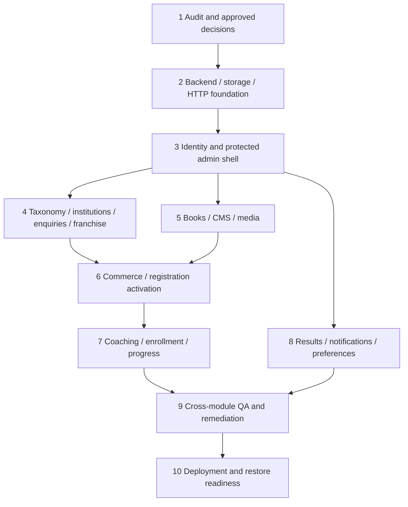

# Dependency-aware implementation roadmap

## Stage 3 current status

Stage 3 was explicitly approved with Q03-A through E and SMTP/app-password delivery. Identity/session/CSRF/RBAC/invitation/bootstrap/audit and existing frontend auth integration are implemented and tested; evidence/limits are in 10/13 and backend README. Standalone MongoDB is approved, configured and startup/readiness verified; no replica set/Docker setup is required here.

Live SMTP remains unverified (credentials absent); no real initial administrator was created. Existing admin business screens are read-only previews; invitation security controls are operational. Stage 4 requires owner acceptance, applicable domain decisions and separate approval. Before real-user onboarding, configure and verify authorized SMTP delivery. Stage 6 requires credential rotation and a separately approved payment-consistency strategy. Earlier Stage 2 statements below are historical snapshots.

Stage 2 status (23 October 2026): **approved foundation implementation delivered**, with 25 passing backend tests, one explicitly skipped real-MongoDB integration test and five passing client tests; baseline/final frontend build passed. Current environment has no local replica set, so successful real-DB startup/readiness remains a setup verification gate, not a claimed completed check. See [implementation/setup](../../backend/README.md), [verification record](10-INTEGRATION-AND-TESTING.md) and the Stage 2 subsection in [checklist](13-MASTER-IMPLEMENTATION-CHECKLIST.md). No business modules or Stage 3 code were started. Next work after separate approval is Stage 3, with Q03 identity/recovery decisions and a standalone MongoDB/SMTP configuration for integration. Stage 6 credential rotation remains mandatory before payment integration; nothing has been rotated or connected in Stage 2.

Phase 1 ends with these documents and explicit approval before code changes. Later stages below are proposals, not permission to begin. Each stage is independently reviewable. Build vertical slices so a working admin mutation and user read path are validated together, rather than postponing all integration to the end. Do not expose the current unprotected admin during transition.

Documentation decision update, 23 October 2026: Razorpay is confirmed for applicable paid registration fees, book purchases, prepaid coaching passes and renewals, using Standard Checkout with backend-created orders. Preserve the ten-stage order and existing feature/API IDs. PaymentService keeps SDK calls inside the Razorpay adapter. The compromised exposed test credential must be revoked/rotated and replacement confirmed **before Stage 6 payment integration or any earlier provider-connected spike/test**. Development/integration tests use Razorpay Test Mode only; no live payment during implementation/testing without explicit approval. Fee amounts, tax treatment, refunds and invoice compliance remain Q01/Q02/Q09; recurring billing remains out of scope.

## Dependency overview

Stage 8 trusted results depends on approved source Q07, not merely stage 3. Paid flows cannot launch before stage 6. Public read-only catalogue/CMS work can be reviewed earlier without granting paid access. The arrows indicate dependencies, not authorization to use parallel agents or separate teams.

## Stage 1 — Repository analysis and approval (this delivery)

- **Objective:** establish the actual frontend requirements and reviewable system plan.
- **Scope/tasks:** source and route audit, hardcoded and interaction inventory, model/API/admin/security/storage plans, decision register and traceability.
- **Files:** only `docs/development-plan/01-...13-...md`.
- **Dependencies:** repository access and pasted Phase 1 instructions; no external account access required.
- **Deliverable:** 13 cross-referenced Markdown documents, verified counts and documented static-inspection limitations.
- **Acceptance:** every current route/page/core shared control represented; prototype admin and security defects explicitly recorded; proposed features distinguished from marketing/unmounted code.
- **Testing/checks:** documentation structure/link/route/evidence checks and Git diff scope; no implementation test claim.
- **Risks:** ambiguous fee/access/results/identity policies; decisions listed in 12.
- **Definition of done:** documents complete, only docs changed, final summary delivered, implementation awaits explicit approval.

## Stage 2 — Foundation (recommended first implementation stage)

- **Objective:** make the future service start safely and support testable HTTP/database/storage boundaries.
- **Scope/tasks:** Node/Express JavaScript package and supported version selection; module skeleton; validated env example/ignore rules (blank Razorpay placeholders and Test Mode default); MongoDB connection with replica-set development setup; app/server split; request IDs/error format/log redaction/CORS/headers; health routes; LocalStorageProvider and media lifecycle foundation; shared frontend HTTP client without replacing every feature yet. Reserve commerce PaymentService/provider boundaries without gateway calls before the credential-rotation gate.
- **Affected files/modules:** new `backend/src/{config,middleware,storage,utils}`, `backend/{package.json,.env.example,tests}`, ignore/deployment documentation; root scripts only if required; proposed `frontend/src/shared/api`.
- **Dependencies:** Stage 1 approval; Q10 local host/volume/database defaults can be selected for development without provisioning production.
- **Deliverables:** reproducible local setup, safe health responses, persistent local upload prototype behind auth-ready boundary, shared errors/config, test harness.
- **Acceptance:** missing required config fails with redacted messages, no secrets exposed, DB/volume readiness correct, private directory inaccessible publicly, clean shutdown.
- **Tests:** env validation, health/error integration, safe path and storage stream/cleanup behavior; no business module endpoint considered complete.
- **Risks:** unsupported runtime packages, file permissions/proxy assumptions, standalone DB lacking transactions.
- **Definition of done:** startup/storage/error contracts reviewed, commands documented, checks pass; no demo endpoint exposed as production business functionality.

## Stage 3 — Identity, permissions and admin shell

- **Objective:** remove mock authentication and make staff/user access enforceable.
- **Scope/tasks:** User/Session/AuthChallenge; opaque secure cookies/CSRF; canonical me/login/logout/password/reset/email-change; server single-session transfer; staff bootstrap/invite/roles; permission middleware; AuthContext bootstrap and route guards; authenticated current AdminLayout with account/logout, responsive shared controls and user cache clearing.
- **Affected:** auth/users modules, shared client/query cache, AuthContext, auth pages/profile password flow, AdminRoutes/AdminLayout/new admin login; no wholesale user redesign.
- **Dependencies:** Stage 2, approved Q03 decisions; standalone MongoDB and fake/sandbox SMTP for tests. Registration activation full business flow comes later.
- **Deliverables:** A01-A14/A09 staff-invite activation, B14-B18, role matrix enforcement, authenticated admin shell and null/guest state.
- **Acceptance:** no frontend password/token persistence/default logged-in user, direct admin API calls enforce permissions, session transfer revokes previous device, reset is single-use.
- **Tests:** T02/T13/T14 identity cases, concurrent transfer, CSRF/CORS/IDOR, role escalation, recovery delivery sandbox, narrow viewport/keyboard shell.
- **Risks:** breaking implicit mock-user dependencies and route-state credential assumptions.
- **Definition of done:** protected boundaries and identity tests pass; residual mock consumers isolated and cannot grant access.

## Stage 4 — Taxonomy, institutions and intake slice

- **Objective:** make real partner directories and enquiry/franchise review work end-to-end.
- **Scope/tasks:** taxonomy and location associations; University/College/CollegeProgram; metadata and logos; list/detail/facets APIs and existing admin CRUD integration; fix getCourses method mismatch; AdmissionApplication and notes endpoint; FranchiseApplication draft/document-free-submit/status/reviewer workflow; uploads and approval deferred per confirmed policy, no guessed affiliations.
- **Affected:** taxonomy/institutions/admissions/franchises/media modules; collegeService/adminService; listing pages, admission/details/franchise modals; five institution/review admin pages.
- **Dependencies:** Stages 2-3; Q04 enquiry guest policy and Q06 franchise approval effect; Q05 document retention before live intake.
- **Deliverables:** A20-A31, G01-G04, B02-B09; real persisted partner hierarchy, enquiries and notes; private franchise documents remain deferred.
- **Acceptance:** state/district/university/program reset works, arbitrary parent IDs rejected, inactive data hidden, archive preserves historical applications, note-only and program listing actually succeed.
- **Tests:** T04/T05/T14; read/write permission negatives, concurrent status/note changes, blocked pending files, owner/capability checks, admin change visible to public filters.
- **Risks:** sparse mock geography and inferred legacy parent mappings; malformed mixed string IDs.
- **Definition of done:** no unapproved seeds imported, implemented stage paths use API data, no local reseed authority; acceptance and responsive checks pass.

## Stage 5 — Books, CMS and real media

- **Objective:** replace static business content and fake documents while preserving existing screens.
- **Scope/tasks:** Book/media/TOC/preview and metadata extraction; admin actual cover/PDF/sample upload and publication; catalogue filters/facets/detail; CMS pages/banners/faculty/public settings; migrated licensed assets/approved claims; actual reader rendering behind protected bytes; wishlist/bookmark/progress contracts foundation. Private paid reading remains locked until commerce entitlement exists, test with explicit fixture grants.
- **Affected:** books/content/media/learning foundations; bookService and LibraryContext adapters; Home/About/Categories/shell/banners; BooksHome/Details/PdfReader/BookPreview; AdminBooksPage and new CMS/taxonomy/media screens.
- **Dependencies:** Stages 2-3; approved content/assets Q11 and reader/free policy Q04.
- **Deliverables:** A32-A42/A69-A75, G05/G09-G11, B31/B33/B35-B37; real PDF in existing shell; production reset-to-mock removed.
- **Acceptance:** no draft leaks by ID, real preview is subset, private PDF denied without rights, every business block in 03 is administratively sourced or explicitly owner-deferred; zero-result/empty-banner safe.
- **Tests:** T01/T06/T08 upload validation/private range/TOC/PDF export visual compatibility; admin edit reflects on public pages; no source style regression.
- **Risks:** no real PDFs supplied, unlicensed external images, CMS schema drift, PDF renderer bundle/performance.
- **Definition of done:** approved publication/asset lifecycle works end-to-end; technical constants remain code; in-scope content references no mocks.

## Stage 6 — Verified commerce and paid registration

- **Objective:** make book/course/registration payment authoritative, recoverable and auditable.
- **Scope/tasks:** existing Order/PaymentAttempt/Job models and PaymentService/Razorpay adapter; backend current pricing -> internal pending order -> backend Razorpay order -> Standard Checkout -> Checkout signature plus provider capture/ownership/order binding/amount/currency verification -> signed raw-body webhooks -> atomic verified payment and exactly-once registration/book/enrollment/renewal effect -> authoritative A58 status. Add creation/verification/event/fulfillment idempotency, failure recovery/reconciliation, invoice ownership, admin references/status filters/history and verified financial summaries; RegistrationApplication typed fields/documents/capability and approved fee configuration; study/tuition/faculty form submissions, canonical activation; remove direct completion bypasses and inline card collection. No recurring-subscription integration or duplicate payment endpoints/models.
- **Affected:** commerce/applications/auth/learning/jobs modules; razorpayService/orderService/authService; BookCheckout, CourseDetails/Subscribe checkout integration, all registration forms/success pages; new admin registrations/orders.
- **Dependencies:** Stages 2-5 as applicable; Q01-Q05/Q09 policy decisions; mandatory authorized-owner revocation/rotation of the compromised test credential with confirmation before payment integration; fresh Razorpay Test Mode and environment-isolated webhook setup, SMTP activation delivery. No live payments during implementation/testing without explicit approval.
- **Deliverables:** A15-A19/A54-A61, B10-B13/B22-B24; immutable order state, BookEntitlement and fee-activation effects; explicit pending/error UX.
- **Acceptance:** spoof/replay cannot grant access; cancelled/failed/pending capture do not grant; lost callback, delayed webhook/network interruption and temporary DB failure recover via shared settlement/reconciliation once; admins cannot mark unpaid as paid; summary/history derive from verified records; credentials correspond to actual canonical account; all collected fields/file IDs survive reload; faculty no admin role.
- **Tests:** T03/T07/T09/T14/T16; Razorpay Test Mode only; creation-key concurrency and unknown provider-create outcome; signature/owner/order/amount/currency/mode tamper; callback/webhook replay/out-of-order delivery; transaction fault injection and reconciliation after DB recovery; exactly-once renewal/activation; admin history/status/verified sums; duplicate email, expired capability, post-capture activation failure and invoice ownership.
- **Risks:** fee meaning/receipt taxation unresolved, payment provider config/account access, activation privacy rules.
- **Definition of done:** rotation prerequisite evidenced without storing credentials; Razorpay Test Mode contracts and resilience tests pass; secrets absent from frontend/source artifacts, only publishable Key ID and Checkout data returned; no browser-only entitlement/payment mutations; API IDs/models unchanged; unresolved financial policies explicitly gated, no recurring billing or unapproved live transaction.

## Stage 7 — Coaching, enrollment and progress

- **Objective:** deliver real paid/free coaching access across both existing interfaces.
- **Scope/tasks:** canonical course/subject/chapter/Lesson/Book links/CoursePlan; explicit validity; curriculum/plan editor and publish validation; real selector facets/preferences; per-user Enrollment, free join eligibility, renewal via verified order; syllabus adapter for subjectsData and legacy chapters; protected MP4 ranges, actual course book reader, checkpoint/completion/bookmarks; student summaries derived.
- **Affected:** coaching/learning/commerce/media modules; coachingService/LibraryContext/subscription adapter cleanup; all 11 coaching page files; player/list/sidebar/progress/expiry components; new admin coaching/plans/enrollments screens.
- **Dependencies:** Stages 3/5/6, Q02/Q04/Q08; licensed content and capacity plan.
- **Deliverables:** A43-A53, G06-G08, B19-B21/B32; one catalogue/identity/access model and no seeded completion/expiry.
- **Acceptance:** paid join cannot bypass charge; plans match between screens; one student's renewal does not change others; invalid/locked resource rejected; expired access denied server-side; both players reflect same completion.
- **Tests:** T09/T10; expiry boundary/timezones, double renewal, access revocation/range/seek, mobile orientation/fullscreen, course book rights versus permanent book purchase.
- **Risks:** duplicate legacy IDs/shapes and empty generated degree courses; local video disk/bandwidth limits.
- **Definition of done:** canonical syllabus migration and real media work; placeholder tests/notes are explicitly resolved without silent scope expansion; learning journeys pass.

## Stage 8 — Trusted results, notifications and remaining account integration

- **Objective:** finish observed results/notices/settings without fabricated content or false success.
- **Scope/tasks:** approved result issuer/exam field schemas and source adapter/import dry-run, provenance/marks validation, reviewer publication/correction/withdrawal, exact authorized lookup/history; remove generated identities/marks and false signature/QR; preserve print/PDF; notifications targeting/read state/header counts; profile/notification preferences/cache-clear behavior; finish public settings migration.
- **Affected:** results/notifications/users/content/audit/jobs; resultService/notificationService; ResultsPage/result components, Profile/Settings/Header; result/notifications/settings admin screens.
- **Dependencies:** Stage 3 and storage/CMS foundations; Q05/Q07 source/privacy, Q08 history surface and placeholder decisions. Results cannot launch if source absent; build only approved configuration and disabled state then explicitly mark result ingestion deferred.
- **Deliverables:** A62-A68, G12-G14, B25-B30/B34/B38-B39 where operations needed.
- **Acceptance:** unknown roll never produces record, wrong issuer/verification denied, real source values reproduced; notices scoped per user, read state persists; no fake cache/password/invoice success.
- **Tests:** T11-T13; exact match/no-match/withdrawn/correction/history isolation, A4 multi-page export, dynamic field validation, notification audience/read-all race.
- **Risks:** no external result contract/official signature support; private marksheet data and PDF capture cross-origin fonts/photos.
- **Definition of done:** approved source tested with fixtures/sandbox, no fabrication in production path, notices/account data integrated; unresolved source scope explicitly carried to launch gate.

## Stage 9 — Whole-system QA and integration remediation

- **Objective:** close remaining mock/contract/security/visual gaps and prove admin-to-student workflows.
- **Scope/tasks:** traceability T01-T16; all expanded API permission cases; account isolation; data migration dry-run; production grep for mocks/demo defaults; phase-specific acceptance review; all admin routes/eight widths; user baseline regression; pending/failure/empty/slow paths, accessibility and performance; audit log visibility/secret redaction.
- **Affected:** module tests, frontend E2E/visual fixtures, defect-specific source changes, documentation updated for final contracts.
- **Dependencies:** implemented in-scope stages 4-8, approved decisions; results deferral cannot be hidden as a pass.
- **Deliverables:** test matrix/results, defects resolved, migration report and precise remaining approved exclusions.
- **Acceptance:** no critical/high security or data integrity defects; no missing feature trace row; true admin updates visible within freshness target; no unauthorized UI changes.
- **Tests:** complete 10 strategy, provider sandbox smoke, fault injection, cross-user/role matrix, responsive all routes.
- **Risks:** testing only happy path/homepage, hidden overflow masking regressions, mocks inadvertently imported into build.
- **Definition of done:** agreed launch features pass, every unresolved finding has owner/severity/approved treatment; no tests marked passing without execution evidence.

## Stage 10 — Deployment preparation and release review

- **Objective:** prove production operation before an authorized deployment.
- **Scope/tasks:** staging topology/TLS/origin/proxy/routes, Mongo replica set/index migration, persistent local volume and disk quotas, secret injection/rotation, email/payment live-mode readiness without test mixing, backup+restore/rollback drills, job leases/reconciliation alerts, readiness/monitoring/log retention, exact-origin CORS/media/browser checks; deployment/setup/operator docs.
- **Affected:** future backend/container/reverse-proxy/CI configuration, frontend hosting rewrite, env examples and runbooks; no deployment account mutation in Phase 1.
- **Dependencies:** Stage 9, Q09-Q11, approved production host/domain/account ownership and release authorization.
- **Deliverables:** reviewable staging build, restore/rollback evidence, environment checklist, ownership/runbooks and release candidate.
- **Acceptance:** redeploy/restart retains files and entitlements; private paid assets not static-public; backup restores DB/file consistency; all routes/deep links/API/proxy work; no frontend secret or demo production user.
- **Tests:** staging E2E and health, live-provider config validation without unauthorized charges, backup restore, rollback, disk-full simulation, alert delivery.
- **Risks:** ephemeral filesystem, mismatched frontend API origin, webhook reachability, absent on-call/backup ownership.
- **Definition of done:** concrete artifacts and checks reviewed; external deployment/publishing only after applicable user authorization; monitor and rollback plan ready.

## Review and estimation policy

Each stage should be split into pull-request-sized slices (schema/API -> admin -> user integration -> critical tests) as needed, without marking a stage done while any necessary layer remains mocked. Track document 13 as work proceeds; keep future tasks unchecked in this Phase 1 delivery. No calendar estimate is asserted without team size, asset readiness and provider access; estimate after Q01-Q11 decisions and initial stage-2 throughput. Recommended first approved work is Stage 2, followed by Stage 3 before any production business writes.
## Stage 4 authorization and implementation update — 24 October 2026

The owner accepted Stage 3 and explicitly authorized Stage 4. Q04 admissions require a verified signed-in account; Q06 permits document-free franchise submission for review while approval stays blocked. The implemented slice includes taxonomy/institutions/programs, public directories, admission enquiries, franchise drafts/submission/status and permissioned reviews in existing screens.

A72 secure upload lifecycle is deliberately deferred; selected pending files block final submission. No automatic franchise approval/affiliation/account is implemented. See Stage 4 report for verification and operational limitations. Stage 5 (books/CMS/media) requires separate explicit approval and applicable content/privacy decisions; it has not started. Stage 6 still requires compromised credential rotation and separately approved payment consistency.

## Stage 5 implementation status - 24 October 2026

Stage 5 is implemented: real book/CMS/media models and APIs; existing admin/public frontend integration; standalone durable coordination, snapshots/audits, quarantine/streaming/reference protection; isolated backend/browser regressions and controlled actual-development persistence verification. Actual licensed catalogue publication remains gated on approved source/prices and operational scanning. No replica set, real mail, payments or entitlement activation was introduced.

Stage 6 requires separate owner approval. Before payment integration: rotate the compromised Razorpay test secret and webhook credentials; confirm pricing/free access, taxes/refunds/invoice policy; explicitly approve a standalone-compatible settlement/activation consistency strategy or a topology change. Preserve existing payment API IDs and PaymentService/provider boundary; use Test Mode only unless live testing is explicitly authorized. Continue scanner/licensed-source/operator/retention setup without representing these as already verified production operations. Stage 7 reader/progress/bookmarks remains deferred.

## Stage 6 adopted implementation - 24 October 2026

Stage 6 implements offline/Test Mode architecture and safely defined book-commerce infrastructure on standalone MongoDB: authoritative aggregate, journaled CAS, embedded attempts, durable signed event receipts, leased reconciliation, idempotent entitlement effects, backend-priced orders, public/admin payment states, truthful receipts, registration drafts/fee metadata and guarded frontend Checkout. It does not implement provider-connected validation, registration charges/activation or coaching products/renewals lacking policy/domain.

Operational completion is gated by owner-confirmed fresh API/webhook rotation and read-only Test validation, real provider sandbox order/capture/webhook verification, configured-host collection capacity and its actual persistence smoke, licensed/scanned content, SMTP and approved tax/refund/invoice/registration/free-access rules. No Live Mode or recurring billing. Stage 7 remains separately authorized and must supply real courses/plans/validity/eligibility before commerce can sell or renew them. No automatic Stage 7 work starts here.

## Stage 7 implementation and superseding evidence - 24 October 2026

The owner separately authorized Stage 7 and confirmed backed-up development cleanup. Stage 7 implements safely achievable course/plan/lesson/enrollment/progress and book-reader integrations in the existing architecture. The shared-host collection blocker was resolved by deleting 41 positively identified backed-up obsolete project test databases while retaining the application data. Actual configured-host Stage 3-7 startup/readiness/persistence/restart now succeeds. Earlier assumptions that requireReplicaSet=false proves standalone are corrected: the host advertises a replica set; no topology was changed. A separate local standalone run verifies code compatibility. Current lesson delivery is authored text/scanned PDF; video, free enrollment, renewal extension and manual grants remain blocked rather than fabricated. Stage 8 is not authorized by this implementation. Its trusted results source/provenance/privacy and notification/account requirements must be approved separately.

See [Stage 7 report](../../backend/STAGE7-REPORT.md) and [current backend runbook](../../backend/README.md). Historical earlier-stage status paragraphs remain snapshots, not current operational acceptance.

## Stage 10 owner-authorized scope override - 25 October 2026

The latest Stage 10 instruction supersedes the historical deployment-preparation stage above. Authorized work is completion of original F01-F26 implementable UI/backend/admin connections and isolated end-to-end acceptance. Deployment, hosting/domain setup and production release are explicitly excluded. Existing payment, official-result, registration/privacy, video, free/renewal/manual-grant and fiscal-policy gates remain. Actual implementation and unfinished original requirements are tracked in backend/STAGE10-REPORT.md and backend/STAGE10-FEATURE-TRACEABILITY.md; no inferred production acceptance follows from test adapters.
